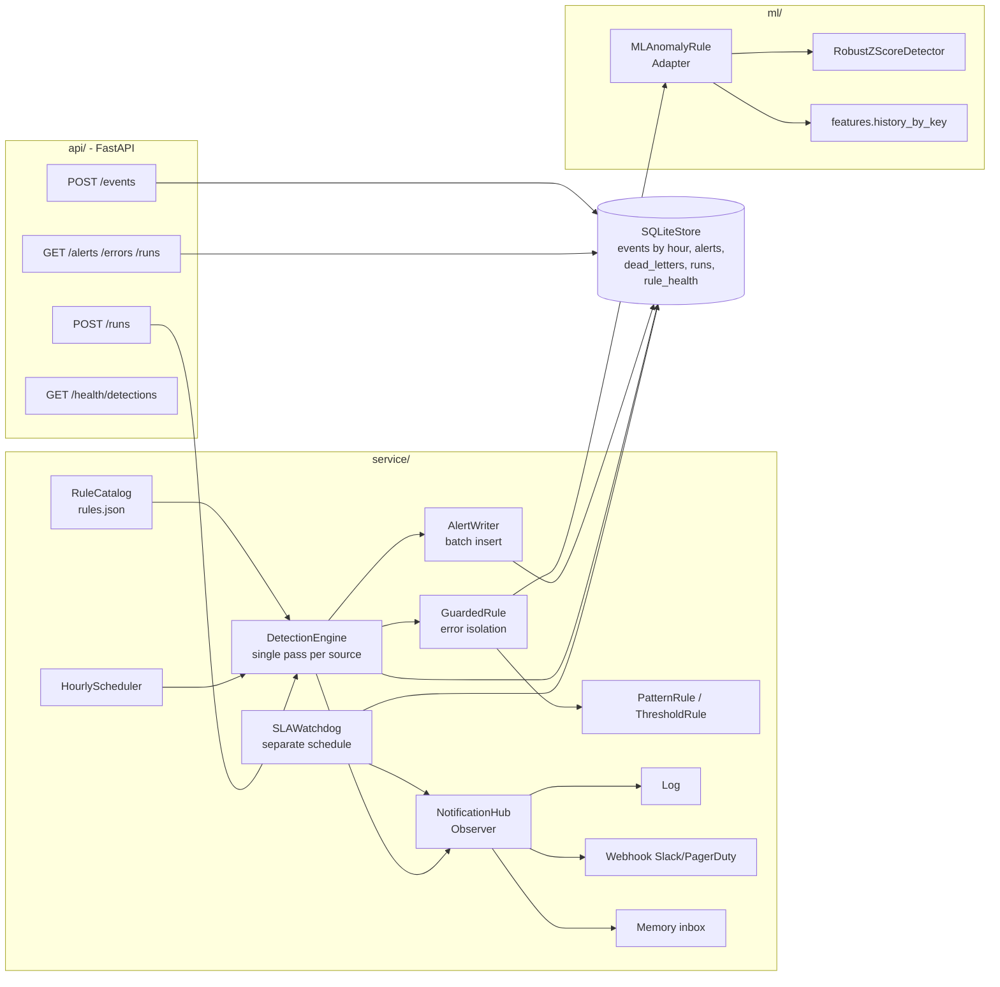
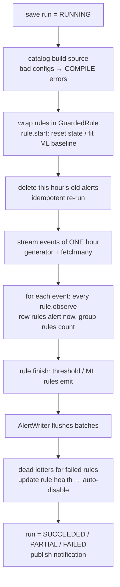

# Hourly Detection Engine (Python reference project)

A generic, runnable version of the "hourly detections" system design problem. Use it as a reference for **system design**, **design patterns**, **Python fundamentals** and **ML integration** in interviews.

## 1. Problem (generic)

Several log sources (EDR/process logs, auth logs, cloud audit logs, …) write events continuously, about 50M rows/hour per source in production. Every hour we must:

1. Run **N detection rules** (hundreds) on the **previous hour** of data. Rules can be row patterns, per-entity thresholds, or ML anomaly checks.
2. Save matches to an **Alerts** store.
3. Make sure **one broken rule doesn't fail the whole run**.
4. **Raise an alarm** if the run doesn't finish within the hour.

| Non-functional requirement | How it is handled |
|---|---|
| Finish within 1 hour | One scan per source (not per rule); sources run in parallel; storage is partitioned by hour |
| Fault isolation | Per-rule try/except (`GuardedRule`), dead-letter table, auto-disable after 3 bad runs |
| Idempotent / re-runnable | Delete + insert per (source, hour) and a UNIQUE key on alerts |
| Observability | Run-status table, notifications, `/health/detections`, independent SLA watchdog |
| Extensible | New rule types plug in through a registry; the engine doesn't change |
| Secure | Rules are safe JSON conditions (no `eval`), parameterized SQL, API key, input validation |

## 2. Architecture



### What one run does (per source, in parallel)



### SLA monitoring

The run for hour **H** starts at H+1:05 and must finish by **H+2:00**. `SLAWatchdog` runs on its **own** schedule and only reads the `runs` table, so it still fires if the engine hangs or crashes. It sends:
- `sla.breach` when the newest hour whose deadline has passed is not complete
- `sla.warning` when a run has been RUNNING for more than 40 minutes

As a backup in case this process itself is dead, an external monitor polls `GET /health/detections`, which returns 503 if no run has succeeded in the last 2 hours.

## 3. Folder structure

```
HourlyDetectionEngine/
├── api/
│   ├── app.py          FastAPI routes, API-key auth, lifespan, dependency injection
│   └── schemas.py      Pydantic request models (validation at the boundary)
├── service/
│   ├── models.py       dataclasses + enums (Event, Alert, RunStatus, HourWindow …)
│   ├── rules.py        Rule ABC, Pattern/Threshold rules, registry/factory, GuardedRule
│   ├── catalog.py      rule configs → fresh rule objects per run
│   ├── engine.py       DetectionEngine + AlertWriter (single pass, batching, isolation)
│   ├── repository.py   SQLiteStore (Repository) + DetectionStore Protocol
│   ├── scheduler.py    BackgroundWorker, HourlyScheduler (+backfill), SLAWatchdog
│   ├── notifier.py     NotificationHub (Observer), Log/Memory/Webhook notifiers
│   ├── container.py    composition root (wires everything)
│   └── utils.py        retry decorator, timed() context manager, batched() generator
├── ml/
│   ├── features.py     (hour, key, count) → per-entity hourly series
│   ├── detectors.py    RobustZScoreDetector (median/MAD), IsolationForestDetector
│   ├── ml_rule.py      MLAnomalyRule - adapts a detector to the Rule interface
│   └── metrics.py      precision / recall / F1
├── config/rules.json   example rules (incl. 2 deliberately broken ones)
├── tests/test_engine.py
└── main.py             end-to-end demo with synthetic data
```

## 4. Run it

```powershell
cd Python-For-Dev\HourlyDetectionEngine
py main.py                       # demo: stdlib only
py -m pip install -r requirements.txt
py -m pytest -q                  # 12 tests
uvicorn api.app:app --reload     # http://127.0.0.1:8000/docs
```

What the demo shows:
1. EDR-001/002 fire. EDR-003 (bad regex) fails as a COMPILE error and EDR-004 (comparing a string to a number) fails as a RUNTIME error. Both go to the dead-letter table, and the other rules still alert. The edr run is marked **PARTIAL**.
2. AUTH-001 (threshold rule) catches the brute-force attempt. AUTH-002 (ML) catches the brute force **and** a user whose login volume jumps far above their own baseline; the threshold rule misses that second case.
3. Re-running the same hour gives the same alert count (idempotent).
4. After 3 failed runs in a row, the broken rules are disabled automatically and a `rule.disabled` notification is sent.
5. The watchdog raises `sla.breach` for an hour that was never run.

## 5. Design patterns – where and why

| Pattern | In simple words | Where | Why / interview line |
|---|---|---|---|
| **Strategy** | Many workers share the same job description; the manager just says "do your job" and each does it their own way. | `Rule` subclasses in `rules.py`, `MLAnomalyRule` | Engine calls `start/observe/finish` on every rule without knowing its type |
| **Registry + Factory** | A menu and a kitchen: you order a dish by name ("threshold"), the kitchen looks it up and makes it. A new dish only needs a new menu entry. | `@register("threshold")`, `create_rule(cfg)` | Add new rule types without editing the engine (Open/Closed principle) |
| **Template Method** | A fill-in-the-blanks form: the steps are fixed, each person fills in only their own blanks. | `GroupCountRule` (`prepare`, `evaluate_group`); `BackgroundWorker` (`tick`, `seconds_until_next`) | Base class owns the algorithm; subclasses fill in the steps |
| **Decorator (structural)** | A phone case: it adds protection without changing the phone. | `GuardedRule` wraps a `Rule`, delegates with `__getattr__` | Adds error isolation without changing any rule |
| **Circuit breaker** | The fuse in your house: if something keeps sparking, the fuse trips and cuts it off before it damages everything else. | `GuardedRule.tripped` (per run), `rule_health` auto-disable (across runs) | Stop calling something that keeps failing |
| **Adapter** | A travel plug adapter: your charger works in a foreign socket without changing the charger or the wall. | `MLAnomalyRule` adapts `RobustZScoreDetector` to `Rule` | ML plugs into the same pipeline |
| **Repository** | A librarian: you ask for a book, and you don't care which shelf or building it's in. | `SQLiteStore` behind the `DetectionStore` Protocol | Swap SQLite for S3/ClickHouse/Postgres; easy to fake in tests |
| **Observer / Pub-Sub** | A YouTube channel: the creator posts once and every subscriber gets notified; the creator doesn't call each person. | `NotificationHub` + subscribers | Engine publishes events; Slack/PagerDuty/log subscribe |
| **Dependency Injection / Composition root** | A restaurant kitchen gets ingredients delivered instead of growing its own; one supplier list decides who delivers what. | `container.py`, FastAPI `Depends` | Only one place creates concrete classes |
| **Dead Letter Queue** | The post office's "undeliverable mail" box: problem letters are set aside for checking while the rest of the mail goes out. | `dead_letters` table | Failures are kept for debugging; the run continues |
| **Retry + exponential backoff + jitter** | Calling a busy friend: try again after 1 min, then 2, then 4, at slightly random times so everyone doesn't call at the same moment. | `utils.retry`, `AlertWriter._write`, `WebhookNotifier._post` | Only for transient errors |
| **Batching / buffered writer** | Fill the washing machine before you run it instead of washing one sock at a time. | `AlertWriter` | Fewer round trips; one bulk insert |
| **Idempotency** | Pressing the lift button 5 times still calls the lift once. Re-running the same hour gives the same result. | delete+insert per (source, hour), `UNIQUE(run_hour, rule_id, event_id)` | Retries/backfills never create duplicates |
| **Prototype-ish** | A fresh exam paper for every student, so no one sees the previous student's answers. | `catalog.build` creates fresh rule objects each run | Stateful rules never leak state between runs |

**SOLID:**
- **S:** each module has one job.
- **O:** new rule types are added through the registry.
- **L:** any `Rule` works in the engine.
- **I:** small Protocols (`HistoryProvider`, `RuleHealth`).
- **D:** the engine depends on `DetectionStore`, not on SQLite.

## 6. Python fundamentals – where to look

| Concept | File |
|---|---|
| `@dataclass(frozen=True, slots=True)`, `field(default_factory=…)`, `__post_init__` validation | `models.py`, `rules.Condition` |
| `Enum` subclassing `str` (JSON-friendly) | `models.py` |
| `ABC` / `@abstractmethod`, `@classmethod` alternative constructors, `@property` | `rules.py`, `scheduler.py` |
| `typing.Protocol` (structural typing / duck typing with types) | `repository.DetectionStore`, `rules.HistoryProvider` |
| Generics: `TypeVar`, `ParamSpec` for a typed decorator | `utils.py` |
| Decorator with arguments + `functools.wraps`; class decorator (`@register`) | `utils.retry`, `rules.register` |
| Closures (regex captured in a lambda), dispatch dict instead of if/elif | `rules.Condition`, `OPERATORS` |
| Context managers: class (`__enter__/__exit__`) and `@contextmanager` | `engine.AlertWriter`, `utils.timed`, `repository._connect` |
| Generators, `yield`, walrus `:=`, `itertools.islice`, streaming with `fetchmany` | `repository.iter_events`, `utils.batched` |
| `collections`: `Counter`, `defaultdict`, `deque(maxlen)` | `rules.GroupCountRule`, `notifier.py` |
| Threads: `ThreadPoolExecutor`, `as_completed`, `threading.Event/Lock` | `engine.run_hour`, `scheduler.BackgroundWorker` |
| Exceptions: custom class, `raise … from exc`, isolation boundary | `rules.RuleConfigError`, `GuardedRule` |
| `__getattr__` delegation, `__repr__`, `__call__` (callable objects) | `GuardedRule`, `Rule`, notifiers |
| sqlite3: parameterized queries, `executemany`, `row_factory`, upsert, WAL | `repository.py` |
| Timezone-aware datetimes (always UTC) | `models.floor_hour`, `HourWindow` |
| `statistics.median`, JSON-safe model persistence (no pickle) | `ml/detectors.py` |
| pytest fixtures, `parametrize`, `tmp_path` | `tests/test_engine.py` |
| FastAPI: lifespan, `Depends`, `APIRouter`, Pydantic v2 validation, `secrets.compare_digest` | `api/` |

## 7. ML notes

- **Why median/MAD instead of mean/std?** The outliers we're looking for would pull the mean and std up and hide themselves. Median and MAD are robust to that. A score above 3.5 is the standard cut-off for this method (Iglewicz & Hoaglin).
- **No data leakage:** the baseline is fitted only on the `lookback_hours` **before** the hour being scored.
- **Cold start:** entities with less than `min_history` hours of data use the population baseline instead of their own.
- **Explainable alerts:** each ML alert includes the score, the baseline median and which baseline was used.
- **For several features** (logins, failed logins, distinct IPs, countries) use `IsolationForestDetector`. Evaluate with precision, recall or PR-AUC, not accuracy, because attacks are rare.
- **Production:** keep fitted baselines in a feature store or as JSON (`to_dict`), and watch for drift.

## 8. From this code to production scale (50M rows/hour)

| Here (local) | Production |
|---|---|
| `events` table + `event_hour` index | S3 Parquet `source=/dt=/hour=` partitions, or ClickHouse `PARTITION BY day ORDER BY hour` |
| `iter_events` generator | Spark reads one hour partition (column pruning + predicate pushdown) |
| Python loop over rules per event | Spark: all rules become one array of flags in a single `select` → `explode` (same single-pass idea) |
| `ThreadPoolExecutor` (I/O-bound; GIL limits CPU work) | `ProcessPoolExecutor`, or Spark executors per source / chunk of rules |
| `HourlyScheduler` | Airflow `@hourly` DAG: S3 sensor → ETL → detect → finalize |
| `SLAWatchdog` | Airflow `dagrun_timeout` + failure callback, plus a Grafana/Datadog "no success in 70 min" alert |
| `NotificationHub` → webhook | Slack / PagerDuty / SIEM |
| `rules.json` | Git + PR review + CI that compiles every rule against sample data |

## 9. Likely interview questions (short answers)

1. **Why one scan instead of one query per rule?** 250 rules would read 50M rows 250 times. One scan reads each row once and checks every rule. Cost grows with the amount of data, not the number of rules.
2. **How does one bad rule not fail all?**
   - Bad configs are caught at load time (COMPILE).
   - Runtime errors are caught per rule by `GuardedRule`, and the rule is skipped for the rest of that run.
   - Failures go to the dead-letter table and the run is marked PARTIAL.
   - A rule is auto-disabled after 3 failed runs in a row.
3. **How do you know a run missed the SLA?** A separate watchdog schedule checks the run-status table, and there is an external dead-man's switch on `/health/detections`. Never rely on the job to report that it is late.
4. **Late events?** Start the run 5 minutes after the hour. Re-runs are idempotent, so a backfill can re-process an hour safely. `HourlyScheduler.backfill_missing` re-runs any hour that has no successful run.
5. **Threads or processes?** Threads are fine for I/O (database, HTTP). For CPU-heavy rule evaluation use processes or Spark, because of the GIL.
6. **Why `Protocol` over `ABC`?** `Protocol` is structural: any class with the right methods fits, with no inheritance needed (good for repositories and fakes). `ABC` is used where shared base behaviour is wanted (`Rule`, `GroupCountRule`).
7. **Why not `eval` rule expressions?** It allows code injection. Rules here are data (field / op / value) checked against an allow-list of operators. Regexes come only from reviewed config.
8. **How do you add a new rule type?** Subclass `Rule` (or `GroupCountRule`), add `@register("name")` and implement `from_config`. Nothing else changes.
9. **How do you test it?**
   - Unit tests for rules and the detector.
   - Engine tests with a temporary SQLite file.
   - Watchdog tests with an injected `now`: the clock is a parameter, so time can be controlled in tests.
10. **What would you change for 10× the volume?**
    - Spark or ClickHouse for the scan.
    - Split rules into chunks per source.
    - Streaming for high-priority rules.
    - Autoscaling workers.
    - Alert on run-time trends before the SLA is breached.
