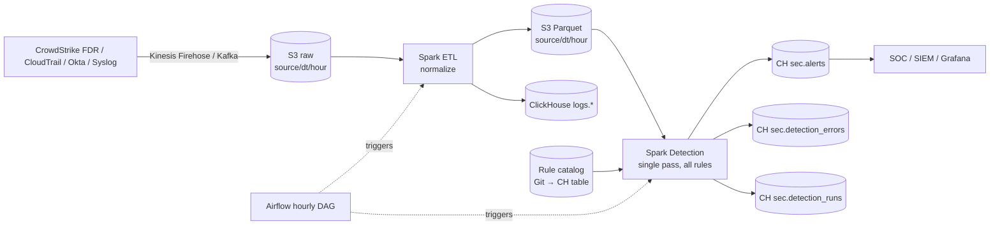

# Hourly Detection Engine – S3 + Spark + ClickHouse + Airflow

Same problem as the Snowflake version: ~50M rows/hour per log source (FDR, CloudTrail, Okta, Syslog …), ~100 columns, 250 detections that run every hour on the previous hour and must finish within the hour. Matches go to `ALERTS`.

**Summary of my choice**
| Area | Decision |
|---|---|
| Storage | Raw logs in **S3**, normalized to **Parquet** partitioned by `source/dt/hour`; loaded into **ClickHouse** (CH) for hunting, alerts and dashboards |
| ETL + Detection | **Spark** reads the hour's partition **once** and checks all rules for that source in a single pass. Alerts are written to CH in one batch |
| Scheduling | **Airflow** hourly DAG: wait for the hour's data → ETL → detect (one branch per source, in parallel) → finalize |
| Errors | Airflow retries for infrastructure errors; rule-level try/except in Spark; bad rules → `detection_errors` (dead letter); malformed records → S3 quarantine |
| Monitoring | `dagrun_timeout` + failure callback → Slack/PagerDuty, a run-status table in CH, Grafana dashboards, and an external dead-man's switch |

---

## 1. Architecture



## 2. Data layout (partitioning)

**S3 (source of truth)**
```
s3://sec-lake/raw/source=fdr/dt=2026-11-04/hour=13/*.json.gz
s3://sec-lake/normalized/source=fdr/dt=2026-11-04/hour=13/*.parquet   (+ _SUCCESS marker)
```
- Partitioned by **event hour**, so a detection run reads only one hour folder (partition pruning).
- Parquet is columnar, so Spark reads only the columns used by rules (not all 100+). Simple filters are pushed down to the file reader.
- Target file size ~128–512 MB. Too many small files slows Spark down.

**ClickHouse**
```sql
CREATE TABLE logs.fdr (
  event_time   DateTime64(3, 'UTC'),
  event_id     String,
  process_name LowCardinality(String),
  process_args String,
  process_path String,
  uid          Int32,
  username     LowCardinality(String),
  -- ~100 more columns
  INDEX idx_args process_args TYPE ngrambf_v1(3, 65536, 3, 0) GRANULARITY 4   -- speeds up LIKE '%-enc%'
) ENGINE = MergeTree
PARTITION BY toYYYYMMDD(event_time)          -- daily partitions; hourly would create too many parts
ORDER BY (toStartOfHour(event_time), process_name, event_time)
TTL toDateTime(event_time) + INTERVAL 90 DAY;

CREATE TABLE sec.alerts (
  run_hour DateTime, source LowCardinality(String), rule_id LowCardinality(String),
  event_time DateTime64(3, 'UTC'), event_id String, username String, process_name String,
  created_at DateTime DEFAULT now()
) ENGINE = ReplacingMergeTree(created_at)     -- re-runs/retries don't create duplicate alerts
PARTITION BY toYYYYMM(run_hour)
ORDER BY (run_hour, rule_id, event_id);

CREATE TABLE sec.detection_errors (           -- dead-letter / operational error table
  run_hour DateTime, source String, rule_id String,
  error_type LowCardinality(String),          -- COMPILE / RUNTIME
  message String, logged_at DateTime DEFAULT now()
) ENGINE = MergeTree ORDER BY (run_hour, source, rule_id);

CREATE TABLE sec.detection_runs (             -- one row per source per hour, used by monitoring
  run_hour DateTime, source String, status LowCardinality(String),   -- SUCCEEDED / PARTIAL / FAILED
  started_at DateTime, finished_at DateTime, alerts_written UInt64, rules_failed UInt32,
  updated_at DateTime DEFAULT now()
) ENGINE = ReplacingMergeTree(updated_at) ORDER BY (run_hour, source);

CREATE TABLE sec.detection_rules (
  rule_id String, source String, condition_sql String,   -- Spark SQL expression
  severity String, enabled UInt8, updated_at DateTime DEFAULT now()
) ENGINE = ReplacingMergeTree(updated_at) ORDER BY rule_id;
```
Rules are stored as data. They are written in Git (YAML), reviewed, checked in CI, and then loaded into `sec.detection_rules`.

## 3. ETL (Spark)

```python
# etl_normalize.py <source> <run_hour ISO>
raw = (spark.read
       .option("mode", "PERMISSIVE")
       .option("columnNameOfCorruptRecord", "_corrupt")
       .schema(SCHEMAS[source])                              # schema includes _corrupt
       .json(f"s3a://sec-lake/raw/source={source}/dt={d}/hour={h}/"))
raw = raw.cache()   # required by Spark before filtering on the corrupt-record column

bad  = raw.where(F.col("_corrupt").isNotNull())
good = normalize(raw.where(F.col("_corrupt").isNull()).drop("_corrupt"))   # rename, cast, UTC

bad.write.mode("overwrite").json(f"s3a://sec-lake/quarantine/source={source}/dt={d}/hour={h}/")
good.repartition(64).write.mode("overwrite").parquet(f"s3a://sec-lake/normalized/source={source}/dt={d}/hour={h}/")
write_ch(good, f"logs.{source}")                             # for hunting / dashboards
```
- `mode("overwrite")` on the exact hour path makes re-runs safe (idempotent).
- Malformed records go to the S3 **quarantine** prefix (dead letter for data). They don't fail the job.

## 4. Detection (Spark) – single pass, batch write

**Idea:** every rule becomes a flag in the **same** `select`. The flags are collected into an array of matched rule IDs and then exploded into one row per match. The result is **one read of the hour and one batch insert into CH**. (A `union` of 250 filters would read the data 250 times.)

```python
# detect.py <source> <run_hour ISO>
import os, sys
from datetime import datetime
from pyspark.sql import SparkSession, functions as F

KEY_COLS = ["event_time", "event_id", "username", "process_name"]
CH_URL = os.environ["CH_JDBC_URL"]                     # credentials come from a secrets manager, not code

def write_ch(df, table):
    (df.write.format("jdbc").mode("append")
       .option("url", CH_URL).option("dbtable", table)
       .option("user", os.environ["CH_USER"]).option("password", os.environ["CH_PASSWORD"])
       .option("batchsize", 100000).save())

def load_rules(spark, source):
    rules = (spark.read.format("jdbc").option("url", CH_URL)
             .option("query", "SELECT rule_id, source, condition_sql FROM sec.detection_rules FINAL WHERE enabled = 1")
             .option("user", os.environ["CH_USER"]).option("password", os.environ["CH_PASSWORD"]).load())
    return [r.asDict() for r in rules.where(F.col("source") == source).collect()]

def alerts_df(df, rules, source, run_hour):
    flags = F.array(*[F.when(F.expr(r["condition_sql"]), F.lit(r["rule_id"])) for r in rules])
    hits = F.filter(flags, lambda x: x.isNotNull())
    return (df.select(*KEY_COLS, hits.alias("hits"))
              .where(F.size("hits") > 0)
              .select(F.lit(run_hour).cast("timestamp").alias("run_hour"),
                      F.lit(source).alias("source"),
                      F.explode("hits").alias("rule_id"), *KEY_COLS))

def main(source, run_hour_iso):
    spark = SparkSession.builder.appName(f"detect_{source}").getOrCreate()
    run_hour = datetime.fromisoformat(run_hour_iso)
    started = datetime.utcnow()
    df = spark.read.parquet(
        f"s3a://sec-lake/normalized/source={source}/dt={run_hour:%Y-%m-%d}/hour={run_hour:%H}/")
    rules, errors = load_rules(spark, source), []

    # 1) compile check: bad syntax / unknown column fails here without running a Spark job
    good = []
    for r in rules:
        try:
            df.select(F.expr(r["condition_sql"]))
            good.append(r)
        except Exception as e:
            errors.append((r["rule_id"], "COMPILE", str(e)[:2000]))

    # 2) happy path: all rules in one pass; on a runtime failure, isolate the bad rule
    if good:
        try:
            write_ch(alerts_df(df, good, source, run_hour), "sec.alerts")
        except Exception:
            df = df.cache()
            for r in good:
                try:
                    write_ch(alerts_df(df, [r], source, run_hour), "sec.alerts")
                except Exception as e:
                    errors.append((r["rule_id"], "RUNTIME", str(e)[:2000]))

    if errors:
        write_ch(spark.createDataFrame(
            [(run_hour, source, rid, et, msg) for rid, et, msg in errors],
            "run_hour timestamp, source string, rule_id string, error_type string, message string"),
            "sec.detection_errors")

    status = "SUCCEEDED" if not errors else ("FAILED" if len(errors) == len(rules) else "PARTIAL")
    write_ch(spark.createDataFrame(
        [(run_hour, source, status, started, datetime.utcnow(), len(errors))],
        "run_hour timestamp, source string, status string, started_at timestamp, finished_at timestamp, rules_failed int"),
        "sec.detection_runs")
    if status == "FAILED":
        sys.exit(1)                         # let Airflow retry / alert; PARTIAL is not a job failure

if __name__ == "__main__":
    main(sys.argv[1], sys.argv[2])
```
Notes:
- If a batch write fails halfway and the fallback rewrites rows, `ReplacingMergeTree` on `(run_hour, rule_id, event_id)` removes the duplicates.
- **Aggregation rules** (e.g. ">10 failed Okta logins per user in 1h"): one `groupBy` pass per source using the same pattern. Rules that look across hours read a 2-hour window.
- **Sizing:** ~50M rows of a few columns is a small job. 10–20 executors on EMR / Spark-on-K8s finish in minutes. Spot instances are fine for executors because Airflow retries the task if one is lost.

## 5. Scheduling – Airflow DAG

```mermaid
flowchart LR
  subgraph per source - dynamic, parallel
    W[wait_for_hour<br/>S3KeySensor _SUCCESS] --> E[etl_normalize] --> D[detect]
  end
  D --> F[finalize<br/>trigger_rule=ALL_DONE]
```

```python
from datetime import timedelta
import pendulum
from airflow import DAG
from airflow.utils.task_group import TaskGroup
from airflow.utils.trigger_rule import TriggerRule
from airflow.operators.python import PythonOperator
from airflow.providers.amazon.aws.sensors.s3 import S3KeySensor
from airflow.providers.apache.spark.operators.spark_submit import SparkSubmitOperator

SOURCES = ["fdr", "cloudtrail", "okta", "syslog"]
HOUR = "{{ data_interval_start.in_timezone('UTC').strftime('%Y-%m-%dT%H:00:00') }}"
PART = "dt={{ data_interval_start.strftime('%Y-%m-%d') }}/hour={{ data_interval_start.strftime('%H') }}"

default_args = dict(
    retries=2, retry_delay=timedelta(minutes=2), retry_exponential_backoff=True,
    execution_timeout=timedelta(minutes=30),
    on_failure_callback=notify_oncall,              # Slack / PagerDuty
)

with DAG(
    dag_id="hourly_detections",
    schedule="@hourly",                   # run for [H, H+1) starts right after H+1:00
    start_date=pendulum.datetime(2026, 11, 1, tz="UTC"),
    catchup=True,                         # missed hours are backfilled automatically
    max_active_runs=2,                    # a slow hour doesn't block the next one
    dagrun_timeout=timedelta(minutes=55), # SLA: the whole run must finish within the hour
    on_failure_callback=notify_oncall,    # also fires on dagrun timeout
    default_args=default_args,
) as dag:

    detects = []
    for src in SOURCES:
        with TaskGroup(group_id=src):
            wait = S3KeySensor(
                task_id="wait_for_hour",
                bucket_key=f"s3://sec-lake/raw/source={src}/{PART}/_SUCCESS",
                mode="reschedule", poke_interval=60, timeout=15 * 60)   # ingestion lag check
            etl = SparkSubmitOperator(
                task_id="etl_normalize", application="s3://sec-jobs/etl_normalize.py",
                application_args=[src, HOUR], conn_id="spark_default")
            detect = SparkSubmitOperator(
                task_id="detect", application="s3://sec-jobs/detect.py",
                application_args=[src, HOUR], conn_id="spark_default")
            wait >> etl >> detect
            detects.append(detect)

    finalize = PythonOperator(
        task_id="finalize", python_callable=summarize_run,   # reads sec.detection_runs, alerts on PARTIAL/FAILED
        op_kwargs={"run_hour": HOUR}, trigger_rule=TriggerRule.ALL_DONE)
    detects >> finalize
```
- `data_interval_start` is always the hour being processed, so retries and backfills use the correct window.
- One branch per source: a failure in one source doesn't stop the others.
- If there are many sources, use dynamic task mapping (`.expand(...)`), or EMR (`EmrAddStepsOperator`) / Spark-on-K8s (`SparkKubernetesOperator`) instead of `spark-submit`.

## 6. Error handling – summary

| Level | Mechanism |
|---|---|
| Bad record (malformed JSON) | Spark `PERMISSIVE` mode → S3 `quarantine/` prefix; count is monitored |
| Bad rule – syntax/unknown column | Compile check in Spark → `detection_errors` (COMPILE); other rules still run |
| Bad rule – runtime error | Batch falls back to per-rule runs → `detection_errors` (RUNTIME); status `PARTIAL` |
| Repeated bad rule | Auto-disable after 3 consecutive failures (`enabled = 0`) + notify the rule owner |
| Infrastructure (S3 throttling, executor/spot loss, CH down) | Airflow retries with exponential backoff; then `on_failure_callback` |
| Late data | `S3KeySensor` waits up to 15 min for `_SUCCESS`; if it times out → "ingestion lag" alert, not a silent zero-alert hour |
| Re-runs / backfill | S3 hour-partition overwrite + CH `ReplacingMergeTree` → idempotent |
| Rule quality | CI compiles every rule against a sample Parquet file before deploy |

## 7. Monitoring & SLA alarm

1. **Airflow SLA:** `dagrun_timeout=55 min` marks the run failed and fires the DAG `on_failure_callback` → PagerDuty/Slack. Per-task `execution_timeout` kills stuck Spark jobs. (Airflow 2 `sla`/`sla_miss_callback` was replaced by Deadline Alerts in Airflow 3.)
2. **External dead-man's switch:** Grafana (or Datadog/CloudWatch) alert on CH:
   ```sql
   SELECT source, max(finished_at) AS last_ok
   FROM sec.detection_runs FINAL
   WHERE status IN ('SUCCEEDED', 'PARTIAL')
   GROUP BY source
   HAVING last_ok < now() - INTERVAL 70 MINUTE;
   ```
   This still fires if the Airflow scheduler itself is down, which the Airflow callbacks can't report.
3. **Metrics:** Airflow StatsD → Prometheus/Grafana (DAG run duration, task failures, sensor wait time). Spark UI/history server (stage time, input size).
4. **Detection health dashboard (Grafana on CH):** run duration trend (to warn before the SLA is hit), rows read per hour, quarantined record count, failed rules, alerts per rule per hour (a sudden 0 or spike = broken rule or broken ingestion).

## 8. Options considered

| Option | Pros | Cons |
|---|---|---|
| **A. One Spark job/Airflow task per detection (250)** | Full isolation; simple ownership | 250 reads of the same hour; 250 Airflow tasks + cluster spin-ups → slow and costly; SLA risk |
| **B. Spark single pass per source (chosen)** | 1 read per source; cost grows with data, not rule count; Spark scales horizontally on S3; rules are metadata | One bad rule can fail the batch → solved by the compile check + per-rule fallback; dynamic expressions are harder to debug |
| **C. Detections as ClickHouse SQL (Airflow runs `INSERT INTO alerts SELECT …` per source)** | Very fast on MergeTree + `ngrambf` index; no Spark cluster for detection; easy for analysts to write | Detection load competes with dashboards/hunting on the same CH cluster; complex logic is limited to SQL |
| **D. Streaming (Kafka + Spark Structured Streaming, or CH materialized views on insert)** | Near-real-time alerts; no end-of-hour spike | More moving parts; windowed/aggregate rules and late data are harder; more expensive to run all the time |

**Choice:** **B**, with the per-rule fallback. ClickHouse is used for storing alerts, hunting and dashboards. Move the highest-priority rules to **D** if the SOC needs alerts in minutes instead of an hour.

## 9. Security & cost
- Rules execute as code (`F.expr`), so they can only change through a reviewed Git → CI pipeline.
- Least privilege: the Spark IAM role can only read `normalized/` and write `quarantine/`. The CH user can insert only into `sec.*`. Secrets come from AWS Secrets Manager / Airflow connections.
- Cost: S3 lifecycle rule (raw → Glacier after 30 days), CH `TTL`, spot executors, and auto-terminating EMR clusters (or Spark-on-K8s with autoscaling).
