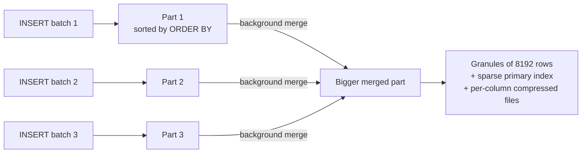
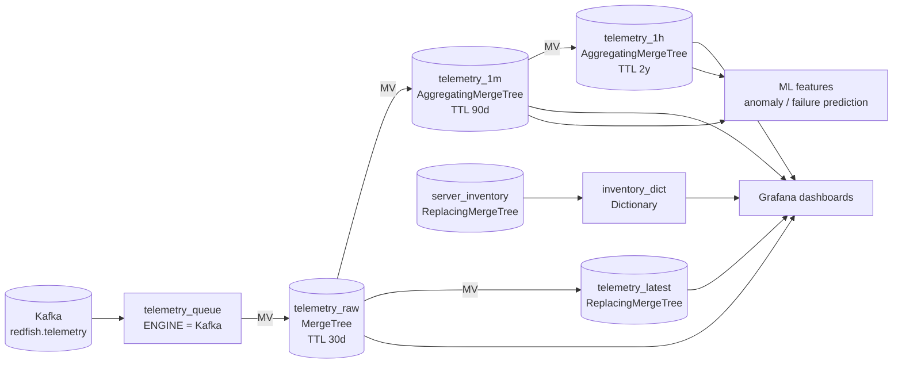
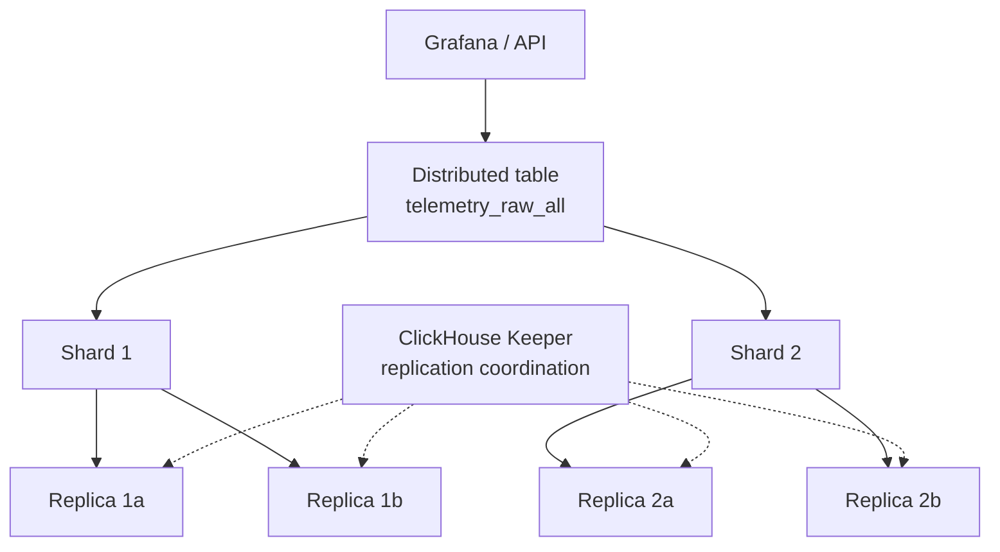

# ClickHouse – Fundamentals for Telemetry (MergeTree, Materialized Views)

How we store and query **Redfish server telemetry** (temperature, power, fans, CPU, …) in ClickHouse, plus the core concepts interviewers ask about.

---

## 1. What is ClickHouse?

An open-source **columnar OLAP database**. It is built to scan and aggregate billions of rows in seconds.

| Feature | Why it matters for telemetry | In simple words |
|---|---|---|
| **Column storage** | A query reads only the columns it uses (e.g. `ts`, `value`) | Read one column of a spreadsheet, not every row |
| **Compression + codecs** | Time series compress 10–30× (similar values next to each other) | Packing similar clothes tightly in a suitcase |
| **Vectorized execution** | Processes blocks of values at once using CPU SIMD | Stamping 1,000 envelopes in one press |
| **Sparse primary index** | Skips huge chunks of data that can't match | A book index pointing to pages, not every word |
| **Materialized Views** | Pre-aggregate while inserting (rollups) | Keeping a running total instead of re-adding everything |
| **Horizontal scale** | Shards + replicas | More shelves, plus copies of each shelf |

**Good at:**
- logs
- telemetry/metrics
- events
- analytics dashboards
- observability

**Not good at:**
- OLTP (many small updates/deletes, row-level transactions)
- frequent single-row lookups by a non-key column

---

## 2. How MergeTree stores data



| Concept | Meaning | In simple words |
|---|---|---|
| **Part** | Every INSERT creates an immutable, sorted part on disk | A new sorted folder for every delivery |
| **Merge** | Background process that combines small parts into bigger ones (this is where Replacing/Summing/Aggregating logic happens) | Tidying many small folders into one big folder |
| **Granule** | A block of ~8192 rows; the smallest unit ClickHouse reads | A page in the book |
| **Sparse primary index** | One index entry per granule (the first key value), kept in memory | The book's table of contents |
| **Mark** | Pointer from the index to the position in each column file | Page number for each chapter |
| **Partition** | Data split by an expression (e.g. per day); enables dropping whole days and pruning | Separate drawers per day |

**Golden rule: insert in big batches** (thousands to hundreds of thousands of rows), not row by row. Each insert creates a part, so too many tiny inserts give a **"Too many parts"** error. If clients must send small batches, use `async_insert=1` or a Buffer/Kafka engine.

---

## 3. The MergeTree family

| Engine | What happens during merges | Telemetry use | In simple words |
|---|---|---|---|
| **MergeTree** | Just merges sorted parts | **Raw telemetry** | The basic filing cabinet |
| **ReplacingMergeTree(ver)** | Keeps only the latest row (highest `ver`) per ORDER BY key | **Latest value per server/metric**, inventory, dedup of events | Keep only the newest version of each document |
| **SummingMergeTree** | Sums numeric columns for rows with the same key | Counters (bytes, error counts) per minute | Add up receipts with the same date |
| **AggregatingMergeTree** | Merges **aggregate states** (`avgState`, `quantileState`, …) | **Rollups** (1-min, 1-hour avg/min/max/p95) | Keep running averages that can be combined later |
| **CollapsingMergeTree / VersionedCollapsing** | Cancels rows with sign +1/−1 | Changing state (rarely needed) | Write a "minus" entry to undo an old one |
| **Replicated\*MergeTree** | Same as above + replicas kept in sync (ClickHouse Keeper) | Production HA | Copies in another building |
| **Distributed** | No data of its own; routes queries/inserts to shards | Cluster-wide table | A receptionist sending you to the right shelf |
| **Kafka** | Reads from a Kafka topic (used with an MV) | **Ingest `redfish.telemetry`** | A pipe from the mailbox |
| **Dictionary** (not a table engine) | In-memory key→value lookup | **Inventory lookup** (model, firmware by `server_id`) | A phone book kept on your desk |

**Important:** Replacing/Summing/Aggregating apply **only when parts merge**, which happens at an unknown time. Your queries must still be correct before merges. Use `GROUP BY` with `argMax` / `-Merge` functions, or `FINAL` (slower).

---

## 4. Designing a table: the key choices

| Choice | Rule | Telemetry choice |
|---|---|---|
| **ORDER BY** (sorting key = primary key by default) | Put the columns you **filter on most** first, from lower to higher cardinality, ending with time | `(server_id, metric, ts)` |
| **PARTITION BY** | Coarse, for data management (TTL, drop). Usually by day or month. **Not** by high-cardinality columns. Aim for < ~1000 partitions | `toYYYYMMDD(ts)` for 30-day raw data |
| **TTL** | Auto-delete or move old data | Raw 30 days, 1-min 90 days, 1-hour 2 years |
| **Codecs** | `DoubleDelta` for timestamps, `Gorilla` for float metrics, `Delta`/`T64` for integers, plus `ZSTD` | Big storage savings |
| **LowCardinality(String)** | Dictionary-encoded strings for columns with few distinct values (roughly < 10k) | `metric`, `unit`, `vendor`, `model` |
| **Avoid `Nullable`** | Costs extra storage and CPU; use defaults (0, '') | |
| **Data skipping indexes** | `minmax`, `set`, `bloom_filter`, `tokenbf_v1`, `ngrambf_v1` for columns **not** in ORDER BY | e.g. `bloom_filter` on `firmware_version` |
| **Projections** | A hidden copy of the table with another sort order or pre-aggregation, picked automatically by queries | e.g. sorted by `(metric, ts)` for fleet-wide queries |

**Long vs wide format:**
- **Long** `(server_id, metric, ts, value)`: flexible. A new Redfish metric needs no schema change. This is our choice.
- **Wide** (one column per metric): faster for fixed metric sets, but needs a schema change for every new metric.

---

## 5. Telemetry pipeline in ClickHouse



### 5.1 Raw table
```sql
CREATE TABLE telemetry_raw
(
    server_id  String,
    metric     LowCardinality(String),        -- e.g. 'CPU0_Temp', 'PSU1_PowerWatts', 'Fan3_RPM'
    ts         DateTime64(3, 'UTC') CODEC(DoubleDelta, ZSTD(1)),
    value      Float64              CODEC(Gorilla, ZSTD(1)),
    unit       LowCardinality(String)
)
ENGINE = MergeTree
PARTITION BY toYYYYMMDD(ts)
ORDER BY (server_id, metric, ts)
TTL toDateTime(ts) + INTERVAL 30 DAY DELETE;
```

### 5.2 Ingest from Kafka (Kafka engine + MV)
```sql
CREATE TABLE telemetry_queue
(
    server_id String, metric String, ts DateTime64(3, 'UTC'), value Float64, unit String
)
ENGINE = Kafka
SETTINGS kafka_broker_list = 'kafka:9092',
         kafka_topic_list  = 'redfish.telemetry',
         kafka_group_name  = 'clickhouse-telemetry',
         kafka_format      = 'JSONEachRow',
         kafka_num_consumers = 4,
         kafka_skip_broken_messages = 100;     -- don't stop on a few bad messages

CREATE MATERIALIZED VIEW telemetry_queue_mv TO telemetry_raw AS
SELECT server_id, metric, ts, value, unit
FROM telemetry_queue;
```
- The Kafka table is **only a pipe**; selecting from it directly consumes the messages. The MV moves rows into `telemetry_raw` in batches.
- Keep telemetry messages **flat** (one row per metric point) so they map straight to columns. Alternatives: Kafka Connect ClickHouse sink, ClickPipes (ClickHouse Cloud), or our own batch inserter.

### 5.3 Materialized Views = **insert triggers** (most asked concept)
- In ClickHouse a normal MV is **not** a stored query result that refreshes later.
- It is an **insert trigger**: every block inserted into the source table is transformed by the MV's SELECT and inserted into the target table.
- **In simple words:** every time a delivery arrives, a clerk immediately writes a summary line into the summary ledger.

| Rule | Why |
|---|---|
| Use `TO target_table` | You control the target engine, TTL and ORDER BY; easier to change later |
| MV sees **only new inserts** | Existing data is not processed. Backfill manually with `INSERT INTO target SELECT … FROM source WHERE …` (avoid `POPULATE`, which can miss rows inserted while it runs) |
| MV runs **per insert block**, not on the whole table | Aggregations must be stored as **states** in AggregatingMergeTree and merged at query time |
| MVs can chain | raw → 1m → 1h; inserts by an MV trigger the next MV |
| A JOIN in an MV triggers only on the **left** table | Prefer dictionaries for lookups |
| A failing MV can fail the insert | Keep MVs simple; monitor `system.query_views_log` |
| **Refreshable MV** (`REFRESH EVERY 1 HOUR`, newer versions) | A real periodic recompute, for complex batch transforms |

### 5.4 1-minute rollup (AggregatingMergeTree)
```sql
CREATE TABLE telemetry_1m
(
    server_id String,
    metric    LowCardinality(String),
    minute    DateTime('UTC'),
    avg_state AggregateFunction(avg, Float64),
    p95_state AggregateFunction(quantile(0.95), Float64),
    min_v     SimpleAggregateFunction(min, Float64),
    max_v     SimpleAggregateFunction(max, Float64),
    samples   SimpleAggregateFunction(sum, UInt64)
)
ENGINE = AggregatingMergeTree
PARTITION BY toYYYYMM(minute)
ORDER BY (server_id, metric, minute)
TTL minute + INTERVAL 90 DAY;

CREATE MATERIALIZED VIEW telemetry_1m_mv TO telemetry_1m AS
SELECT
    server_id,
    metric,
    toStartOfMinute(toDateTime(ts)) AS minute,
    avgState(value)                 AS avg_state,
    quantileState(0.95)(value)      AS p95_state,
    min(value)                      AS min_v,
    max(value)                      AS max_v,
    count()                         AS samples
FROM telemetry_raw
GROUP BY server_id, metric, minute;
```
- `-State` functions store a **partial result** (e.g. sum + count for avg) that can be merged correctly later. You can't average averages, but you can merge avg states.
- `SimpleAggregateFunction` is cheaper for functions where the partial result is just the value (`min`, `max`, `sum`, `any`).

Query the rollup with **`-Merge`**:
```sql
SELECT
    minute,
    avgMerge(avg_state)            AS avg_value,
    quantileMerge(0.95)(p95_state) AS p95_value,
    min(min_v)                     AS min_value,
    max(max_v)                     AS max_value
FROM telemetry_1m
WHERE server_id = 'SGH123' AND metric = 'CPU0_Temp'
  AND minute >= now() - INTERVAL 1 DAY
GROUP BY minute
ORDER BY minute;
```

### 5.5 1-hour rollup from the 1-minute table (chained MV)
```sql
CREATE TABLE telemetry_1h AS telemetry_1m
ENGINE = AggregatingMergeTree
PARTITION BY toYear(minute)
ORDER BY (server_id, metric, minute)
TTL minute + INTERVAL 2 YEAR;

CREATE MATERIALIZED VIEW telemetry_1h_mv TO telemetry_1h AS
SELECT
    server_id, metric,
    toStartOfHour(minute)               AS minute,
    avgMergeState(avg_state)            AS avg_state,      -- merge partial states, keep as state
    quantileMergeState(0.95)(p95_state) AS p95_state,
    min(min_v) AS min_v, max(max_v) AS max_v, sum(samples) AS samples
FROM telemetry_1m
GROUP BY server_id, metric, minute;
```
**Result:** dashboards over 30 days read about **720 rows per series** instead of millions of raw points.

### 5.6 Latest value per server/metric (ReplacingMergeTree)
```sql
CREATE TABLE telemetry_latest
(
    server_id String, metric LowCardinality(String), ts DateTime64(3, 'UTC'), value Float64
)
ENGINE = ReplacingMergeTree(ts)                 -- keep the row with the newest ts
ORDER BY (server_id, metric);

CREATE MATERIALIZED VIEW telemetry_latest_mv TO telemetry_latest AS
SELECT server_id, metric, ts, value FROM telemetry_raw;

-- correct even before merges happen:
SELECT metric, argMax(value, ts) AS value, max(ts) AS at
FROM telemetry_latest
WHERE server_id = 'SGH123'
GROUP BY metric;
```

### 5.7 Inventory as a dictionary (enrich telemetry)
```sql
CREATE TABLE server_inventory
(
    server_id String, model LowCardinality(String), firmware LowCardinality(String),
    datacenter LowCardinality(String), version UInt64
)
ENGINE = ReplacingMergeTree(version)
ORDER BY server_id;                             -- fed from the compacted redfish.inventory topic

CREATE DICTIONARY inventory_dict
(
    server_id String, model String, firmware String, datacenter String
)
PRIMARY KEY server_id
SOURCE(CLICKHOUSE(QUERY 'SELECT server_id, argMax(model, version) AS model, argMax(firmware, version) AS firmware, argMax(datacenter, version) AS datacenter FROM server_inventory GROUP BY server_id'))
LAYOUT(COMPLEX_KEY_HASHED())
LIFETIME(MIN 300 MAX 600);                      -- refresh every 5–10 min

-- "Average CPU temperature by firmware version in the last hour"
SELECT dictGet('inventory_dict', 'firmware', tuple(server_id)) AS firmware,
       avgMerge(avg_state) AS avg_temp
FROM telemetry_1m
WHERE metric = 'CPU0_Temp' AND minute >= now() - INTERVAL 1 HOUR
GROUP BY firmware
ORDER BY avg_temp DESC;
```

### 5.8 Simple anomaly check (z-score vs the last 7 days, hourly)
```sql
WITH hourly AS (
    SELECT server_id, minute AS hour, avgMerge(avg_state) AS v
    FROM telemetry_1h
    WHERE metric = 'CPU0_Temp' AND minute >= now() - INTERVAL 7 DAY
    GROUP BY server_id, hour
)
SELECT server_id, hour, v,
       (v - avg(v) OVER w) / nullIf(stddevPop(v) OVER w, 0) AS z
FROM hourly
WINDOW w AS (PARTITION BY server_id)
QUALIFY hour = toStartOfHour(now() - INTERVAL 1 HOUR) AND z > 3
ORDER BY z DESC;
```
(For robust baselines, prefer median/MAD in Python as in `ml/detectors.py`. ClickHouse provides the aggregated features.)

---

## 6. Query performance tips

| Tip | Why |
|---|---|
| Filter on the **ORDER BY prefix** (`server_id`, `metric`) + time range | Uses the sparse index; skips most granules |
| Query **rollups** for long ranges | Raw for the last few hours, 1-minute for days, 1-hour for months |
| Avoid `SELECT *` | Columnar storage: every extra column = extra I/O |
| `PREWHERE` (automatic in most cases) | Reads filter columns first, then the rest only for matching rows |
| `argMax` / `GROUP BY` instead of `FINAL` on big tables | `FINAL` merges at query time and is slower (better in newer versions, but still has a cost) |
| `EXPLAIN indexes = 1` | Shows how many parts and granules were skipped |
| Check `system.query_log` | Find slow and heavy queries (`read_rows`, `memory_usage`) |

---

## 7. Updates, deletes and deduplication

| Need | How | Note |
|---|---|---|
| Delete old data | **TTL** or `ALTER TABLE … DROP PARTITION` | Cheapest |
| Delete specific rows | Lightweight `DELETE FROM … WHERE …` | Rows hidden at once, removed on merge |
| Update rows | `ALTER TABLE … UPDATE` (**mutation**, rewrites parts, heavy) | Avoid; model as new versions with ReplacingMergeTree |
| Duplicate events (Kafka at-least-once) | ReplacingMergeTree on `(…, event_id)`, or insert dedup tokens on Replicated tables | Dedup is eventual (on merge); query with `GROUP BY`/`argMax` if exactness matters |

**In simple words:** ClickHouse is like writing in pen in a ledger. You don't erase lines; you add a newer line, and the clerk throws out old lines when tidying up.

---

## 8. Scaling and high availability


- **Shard:** splits the data. Shard by `cityHash64(server_id)` so one server's data stays together.
- **Replica:** a copy for HA and read scaling (`ReplicatedMergeTree`, coordinated by **ClickHouse Keeper**, which replaces ZooKeeper).
- **Distributed table:** one entry point for queries and inserts across shards.
- **Tiered storage:** TTL `TO VOLUME 'cold'` moves old parts to cheaper disks or S3.
- **Managed options:** ClickHouse Cloud (SharedMergeTree, storage on S3), Altinity, Aiven.

---

## 9. Monitoring ClickHouse

| What | Where |
|---|---|
| Too many parts / merge backlog | `system.parts` (active parts per partition), `system.merges` |
| Slow / heavy queries | `system.query_log` |
| Kafka engine lag / errors | Kafka consumer group lag for `clickhouse-telemetry`; `system.kafka_consumers` (newer versions) |
| MV failures | `system.query_views_log`, server error log |
| Replication health | `system.replicas` (`absolute_delay`, `queue_size`) |
| Disk usage / compression | `system.parts` (`data_compressed_bytes` vs `data_uncompressed_bytes`) |
| Export | Built-in Prometheus endpoint → Grafana |

---

## 10. ClickHouse vs alternatives (for telemetry)

| | ClickHouse | TimescaleDB (Postgres) | Prometheus / VictoriaMetrics | InfluxDB | Elasticsearch / OpenSearch | Druid / Pinot |
|---|---|---|---|---|---|---|
| Model | Columnar SQL OLAP | Row store + time partitions + compression | Metrics TSDB (PromQL) | TSDB | Search engine (inverted index) | Real-time OLAP |
| Strength | Fast aggregations over billions of rows, flexible SQL, cheap storage | Full Postgres (joins, transactions) | Monitoring/alerting, short retention | Simple metrics | Full-text search on logs | Sub-second dashboards at high concurrency |
| Weakness | No OLTP; updates are heavy | Slower at huge scale | High-cardinality labels, long retention | Scale/licensing changes | Expensive storage, weaker aggregations | Complex operations |
| Fit for Redfish telemetry + logs analytics | **Excellent** | Good at medium scale | Good for live ops alerts | OK | Good for log search | Good, more ops effort |

---

## 11. How it fits our design

| Data | Kafka topic | ClickHouse table | Used by |
|---|---|---|---|
| Telemetry | `redfish.telemetry` | `telemetry_raw` → `telemetry_1m` → `telemetry_1h`, `telemetry_latest` | Grafana, ML features (failure prediction), anomaly queries |
| Inventory | `redfish.inventory` (compacted) | `server_inventory` (ReplacingMergeTree) → `inventory_dict` | Enrichment ("by model / firmware / datacenter") |
| Events & logs | `redfish.events`, `redfish.logs` | `server_events` (MergeTree, `tokenbf_v1` index on message) | Hunting, hourly detection rules (as SQL option), RCA |
| Detection alerts | – | `alerts` (ReplacingMergeTree on `(run_hour, rule_id, event_id)`) | SOC/ops dashboards |

---

## 12. Interview Q&A

1. **What is ClickHouse and when would you use it?** A columnar OLAP database for fast aggregations over huge append-mostly data: telemetry, logs, events, analytics. Not for OLTP.
2. **How does MergeTree work?**
   - Each insert writes an immutable part sorted by ORDER BY, and background merges combine parts.
   - A sparse primary index (one entry per ~8192-row granule) lets queries skip data.
3. **ORDER BY vs PARTITION BY?**
   - ORDER BY is the sorting/primary key used to skip granules, so choose it from the most common filters.
   - PARTITION BY is coarse data management (TTL, dropping whole days) and should have low cardinality.
4. **Why batch inserts?** Each insert creates a part. Tiny inserts mean too many parts, merge pressure, and the "Too many parts" error. Batch, or use `async_insert` / the Kafka engine.
5. **What is a Materialized View in ClickHouse?** An insert trigger that transforms each newly inserted block into a target table. It does not refresh over old data (backfill manually). Refreshable MVs exist for periodic recompute.
6. **How do you build rollups correctly?** An MV with `-State` functions into an AggregatingMergeTree, and query with `-Merge`. Chain 1m → 1h with `-MergeState`. You can't average averages, but you can merge states.
7. **ReplacingMergeTree – any gotcha?** Deduplication happens only at merge time (an unknown moment). Query with `argMax`/`GROUP BY` or `FINAL` to get correct results now.
8. **SummingMergeTree vs AggregatingMergeTree?** Summing only adds numeric columns. Aggregating stores any aggregate state (avg, quantiles, uniq).
9. **How do you handle Kafka duplicates?** At-least-once delivery + ReplacingMergeTree keyed by `event_id` (or insert dedup tokens), with dedup-safe queries.
10. **How do you delete or update data?** Prefer TTL and DROP PARTITION. Use lightweight DELETE for a few rows. Avoid `ALTER UPDATE` mutations (they rewrite parts) and model changes as new versions.
11. **How do you choose codecs for telemetry?** `DoubleDelta` for timestamps, `Gorilla` for float gauges, `Delta`/`T64` for counters, plus `ZSTD`. `LowCardinality` for repeated strings.
12. **How do you scale ClickHouse?** Shards (by `cityHash64(server_id)`) + replicas (ReplicatedMergeTree + Keeper), a Distributed table as the entry point, and tiered storage for old data.
13. **How do you enrich telemetry with inventory?** A dictionary loaded from a ReplacingMergeTree inventory table, with `dictGet` in queries. It is faster than JOINs and refreshes periodically.
14. **Raw vs rollup retention?** Raw 30 days, 1-min 90 days, 1-hour 2 years, enforced by TTL per table. Dashboards pick the right table for the time range.
15. **How do you debug a slow query?** `EXPLAIN indexes = 1` (granules skipped?), `system.query_log` (`read_rows`, memory). Check that the filters match the ORDER BY prefix, use rollups, and avoid `SELECT *` and `FINAL`.
