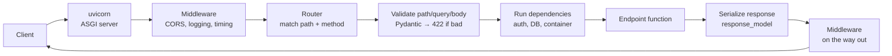

# FastAPI – Interview Notes

Examples refer to this project's [api/app.py](api/app.py) where possible.

---

## 1. What is FastAPI and why use it?

A Python web framework for building APIs. It is built on two libraries:
- **Starlette**: handles web requests (ASGI, routing, middleware, WebSockets).
- **Pydantic**: data validation using type hints.

| Feature | In simple words |
|---|---|
| Type hints → validation | You write `limit: int`, and FastAPI rejects `"abc"` with a clear 422 error |
| Automatic docs | `/docs` (Swagger) and `/redoc` are generated from your code |
| Async support | One worker can handle many slow I/O calls (DB, LLM APIs) at the same time |
| Dependency Injection | Endpoints receive what they need (DB, user, config) instead of creating it |
| Fast | Among the fastest Python frameworks (Starlette + uvicorn) |

**FastAPI vs Flask:**
- Flask is WSGI (sync), and validation and docs need add-ons.
- FastAPI is ASGI (async), with validation, OpenAPI docs and DI built in.

---

## 2. ASGI vs WSGI

- **WSGI** = **Web Server Gateway Interface** (synchronous)
- **ASGI** = **Asynchronous Server Gateway Interface** (async successor to WSGI)

Both are standard "contracts" between a web server and a Python app: uvicorn speaks ASGI to FastAPI, gunicorn speaks WSGI to Flask.

| | WSGI (Flask, Django classic) | ASGI (FastAPI, Starlette) |
|---|---|---|
| Model | One request per thread | Event loop; many requests share one thread while waiting on I/O |
| Supports | HTTP only | HTTP, WebSockets, streaming, long-lived connections |
| Server | gunicorn, uWSGI | **uvicorn**, hypercorn, gunicorn + `UvicornWorker` |

**In simple words:** WSGI is one waiter per table. ASGI is one waiter serving many tables, taking the next order while the kitchen is cooking.

---

## 3. Request lifecycle



---

## 4. Parameters: path, query, body, header

```python
from fastapi import FastAPI, Query, Path, Header, Body

@app.get("/alerts/{rule_id}")
def get_alerts(
    rule_id: str = Path(pattern=r"^[A-Z0-9\-]+$"),     # in the URL path
    limit: int = Query(100, ge=1, le=1000),             # ?limit=50
    x_request_id: str | None = Header(None),            # X-Request-Id header
): ...

@app.post("/events")
def ingest(batch: EventBatch): ...                      # Pydantic model → JSON body
```
**Rule of thumb:**
- A name that appears in the path (`{rule_id}`) is a **path** parameter.
- A simple type (`int`, `str`) is a **query** parameter.
- A Pydantic model is the **body**.

---

## 5. Pydantic models (validation)

```python
from pydantic import BaseModel, Field, field_validator, AwareDatetime

class EventIn(BaseModel):
    event_id: str = Field(min_length=1, max_length=128)
    source: str = Field(pattern=r"^[a-z][a-z0-9_]{0,31}$")
    event_time: AwareDatetime                     # must include timezone
    attributes: dict[str, Any] = {}

    @field_validator("source")
    @classmethod
    def lower(cls, v: str) -> str:
        return v.lower()
```

| Concept | Purpose |
|---|---|
| `Field(...)` | Constraints: `min_length`, `ge`, `le`, `pattern`, default, description |
| `@field_validator` / `@model_validator` | Custom checks (one field / across fields) |
| `model_config = ConfigDict(extra="forbid")` | Reject unknown fields (`"allow"` keeps them) |
| `model_dump()` / `model_validate()` | Model → dict / dict → model (Pydantic v2) |
| Separate **In** / **Out** models | Never return internal fields (e.g. `password_hash`) |

**`response_model`** filters and validates what you return:
```python
class UserOut(BaseModel):
    id: int
    email: str

@app.get("/users/{id}", response_model=UserOut)   # password_hash is dropped automatically
def get_user(id: int): return db.get_user(id)
```

**In simple words:** Pydantic is the security guard at the door. Bad data never reaches your code.

---

## 6. `async def` vs `def` (very common question)

| You write | FastAPI runs it | Use when |
|---|---|---|
| `async def` | On the event loop | Your I/O libraries support `await` (httpx, asyncpg, aioredis) |
| `def` | In a **threadpool** (so it doesn't block the loop) | Blocking libraries (sqlite3, psycopg sync, requests, pandas) |

**The classic bug:** a blocking call inside `async def` freezes **every** request on that worker.
```python
@app.get("/bad")
async def bad():
    time.sleep(5)              # blocks the event loop → whole server stalls
    requests.get(url)          # also blocking

@app.get("/good")
async def good():
    await asyncio.sleep(5)
    async with httpx.AsyncClient() as c:
        r = await c.get(url)
    data = await asyncio.to_thread(cpu_or_blocking_fn, r.json())   # offload blocking work
```
This project uses plain `def` endpoints because `sqlite3` is blocking, so FastAPI runs them in its threadpool.

**CPU-heavy work** (model inference, big pandas jobs): async doesn't help. Use more worker processes, a `ProcessPoolExecutor`, or a job queue.

---

## 7. Dependency Injection (`Depends`)

**In simple words:** like a hotel room that already has towels. The endpoint says what it needs, and FastAPI provides it.

```python
def get_container(request: Request) -> Container:          # from this project
    return request.app.state.container

@api.get("/alerts")
def list_alerts(c: Container = Depends(get_container)):
    return c.store.list_alerts()
```

| Feature | Example |
|---|---|
| **yield dependency** (setup + cleanup) | Borrow a DB connection, `yield` it, return it to the pool afterwards |
| **Sub-dependencies** | `get_repo(conn = Depends(get_db))` → `get_db` runs first |
| **Per-request caching** | If two dependencies both need `get_db`, it runs **once** per request (`use_cache=True` by default) |
| **Router/app-level deps** | `APIRouter(dependencies=[Depends(require_api_key)])` → applies to every route in it (used in this project) |
| **Class as dependency** | `def ep(p: Pagination = Depends())` where `Pagination.__init__(self, skip: int = 0, limit: int = 100)` |
| **Overrides for tests** | `app.dependency_overrides[get_db] = lambda: fake_db` |

```python
def get_db(request: Request):
    with request.app.state.pool.connection() as conn:   # setup
        yield conn                                      # endpoint runs
    # cleanup runs after the response, even on error

def get_current_user(token: str = Depends(oauth2_scheme), db = Depends(get_db)) -> User: ...

@app.get("/me")
def me(user: User = Depends(get_current_user)): return user
```

---

## 8. Lifespan: startup and shutdown

```python
from contextlib import asynccontextmanager

@asynccontextmanager
async def lifespan(app: FastAPI):
    app.state.pool = await asyncpg.create_pool(DSN)    # startup: once
    app.state.model = load_model()                     # e.g. load an ML model once, not per request
    try:
        yield                                          # app serves requests
    finally:
        await app.state.pool.close()                   # shutdown

app = FastAPI(lifespan=lifespan)
```
- `@app.on_event("startup")` / `"shutdown"` are **deprecated**. Use `lifespan`.
- `app.state` holds shared objects such as DB pools, HTTP clients, ML models and config.
- **In simple words:** opening and closing the shop. Turn on the lights once in the morning, not for every customer.

---

## 9. Database connections

| Approach | When |
|---|---|
| **Connection pool** created in `lifespan`, borrowed per request via a `yield` dependency | Postgres/MySQL. Opening a network connection is slow, so reuse it |
| Short connection per query inside the repository | SQLite (local file, cheap) – what this project does |
| Async driver (`asyncpg`, SQLAlchemy async) with `async def` endpoints | High-concurrency I/O |

Pool size × number of workers × number of pods must stay below the DB's `max_connections`. Use PgBouncer when you have many instances.

---

## 10. Error handling

```python
from fastapi import HTTPException
from fastapi.responses import JSONResponse
from fastapi.exceptions import RequestValidationError

raise HTTPException(status_code=404, detail="rule not found")   # client gets {"detail": "..."}

class RuleConfigError(ValueError): ...

@app.exception_handler(RuleConfigError)                          # map domain errors → HTTP once
async def rule_error_handler(request, exc):
    return JSONResponse(status_code=422, content={"detail": str(exc)})
```
| Code | Meaning |
|---|---|
| 200 / 201 / 202 / 204 | OK / Created / Accepted (async job) / No content |
| 400 | Bad request (business rule) |
| 401 / 403 | Not authenticated / authenticated but not allowed |
| 404 / 409 | Not found / conflict (duplicate) |
| **422** | Validation failed (FastAPI's automatic response for bad input) |
| 429 | Too many requests (rate limit) |
| 500 / 503 | Server bug / dependency down (e.g. `/health/detections` returns 503 when stale) |

**Never leak stack traces or internal details in 500 responses.** Log them server-side instead.

---

## 11. Responses: JSON, streaming, files

```python
from fastapi.responses import StreamingResponse, FileResponse, JSONResponse

@app.post("/chat")
async def chat(q: Question):
    async def tokens():
        async for t in llm.astream(q.text):
            yield t
    return StreamingResponse(tokens(), media_type="text/plain")     # LLM token streaming

@app.get("/report")
def report(): return FileResponse("report.pdf")
```
- **Server-Sent Events (SSE):** `media_type="text/event-stream"`. One-way server → client, good for LLM tokens and progress updates.
- **WebSockets:** two-way, real time.
  ```python
  @app.websocket("/ws")
  async def ws(websocket: WebSocket):
      await websocket.accept()
      while True:
          msg = await websocket.receive_text()
          await websocket.send_text(f"echo {msg}")
  ```

---

## 12. Middleware

Code that runs **around every request**: logging, timing, request IDs, CORS, compression.
```python
import time, uuid

@app.middleware("http")
async def add_timing(request: Request, call_next):
    request_id = request.headers.get("X-Request-Id", uuid.uuid4().hex)
    start = time.perf_counter()
    response = await call_next(request)
    response.headers["X-Request-Id"] = request_id
    response.headers["X-Process-Time"] = f"{time.perf_counter() - start:.4f}"
    return response

from fastapi.middleware.cors import CORSMiddleware
app.add_middleware(CORSMiddleware, allow_origins=["https://my-ui.company.com"],
                   allow_methods=["GET", "POST"], allow_headers=["*"])
```
| Middleware | Dependency |
|---|---|
| Runs for **every** request (including 404s) | Runs only for routes that declare it |
| No access to typed parameters | Gets validated params and can be overridden in tests |
| Use for cross-cutting concerns (logging, CORS, timing) | Use for auth, DB sessions, per-route logic |

**CORS in simple words:** the browser asks "is this website allowed to call your API?" Never use `allow_origins=["*"]` together with credentials.

---

## 13. Background tasks vs job queues

```python
from fastapi import BackgroundTasks

@app.post("/runs", status_code=202)
def trigger(req: RunRequest, bg: BackgroundTasks):
    bg.add_task(engine.run_hour, window)      # runs after the response is sent
    return {"status": "accepted"}
```
| `BackgroundTasks` | Celery / RQ / Arq / Kafka consumer |
|---|---|
| Same process; lost if the server restarts | Separate workers; retries and persistence |
| Small, fast jobs (send an email, write a log) | Long or heavy jobs (detection runs, model training, reports) |

In this project, `POST /runs` is synchronous for simplicity. In production it would return **202** with a run ID and use a queue.

---

## 14. Security

| Topic | How |
|---|---|
| **API key** | `APIKeyHeader(name="X-API-Key")` + `secrets.compare_digest` (constant-time compare). Used in this project |
| **OAuth2 + JWT** | `OAuth2PasswordBearer(tokenUrl="token")` → decode/verify JWT (signature, `exp`, audience) in a `get_current_user` dependency |
| **Authorization** | Check roles/scopes in a dependency (`Security(get_user, scopes=["alerts:read"])`) |
| **Input validation** | Pydantic constraints, `extra="forbid"`, max list sizes (prevent huge payloads) |
| **SQL injection** | Always use parameterized queries; never use f-strings with user input |
| **Rate limiting** | `slowapi`, or at the API gateway/ingress |
| **Secrets** | From env/secret manager, never in code; never log tokens |
| **HTTPS, CORS, security headers** | At the ingress/load balancer + `CORSMiddleware` |

```python
from fastapi.security import OAuth2PasswordBearer
oauth2_scheme = OAuth2PasswordBearer(tokenUrl="token")

def get_current_user(token: str = Depends(oauth2_scheme)) -> User:
    try:
        payload = jwt.decode(token, PUBLIC_KEY, algorithms=["RS256"], audience="detection-api")
    except jwt.PyJWTError:
        raise HTTPException(401, "invalid token", headers={"WWW-Authenticate": "Bearer"})
    return User(id=payload["sub"], roles=payload.get("roles", []))
```

---

## 15. Routers and project structure

```python
public = APIRouter(tags=["health"])
api = APIRouter(prefix="/api/v1", dependencies=[Depends(require_api_key)])
app.include_router(public)
app.include_router(api)
```
Typical layout: **routers** (HTTP only) → **services** (business logic) → **repositories** (DB). Keep endpoints thin. That is the `api/` → `service/` split in this project.

**Versioning:** `/api/v1/...` prefix. Add `/api/v2` without breaking old clients.

---

## 16. Testing

```python
from fastapi.testclient import TestClient

def test_alerts():
    app.dependency_overrides[get_container] = lambda: fake_container
    with TestClient(app) as client:                    # `with` runs lifespan
        r = client.get("/api/v1/alerts", headers={"X-API-Key": "test"})
        assert r.status_code == 200
    app.dependency_overrides.clear()
```
- For async tests, use `httpx.AsyncClient(transport=ASGITransport(app=app))` with `pytest-asyncio`.
- Test validation (expect 422), auth (expect 401/403), and the happy path.

---

## 17. Deployment and performance

| Topic | Answer |
|---|---|
| Run | `uvicorn api.app:app --host 0.0.0.0 --port 8000 --workers 4` |
| Production | `gunicorn -k uvicorn.workers.UvicornWorker -w 4 api.app:app`, or one uvicorn per container and scale pods in K8s |
| How many workers? | About the number of CPU cores (each worker is a separate process with its own event loop and its own copy of the ML model in memory) |
| Health checks | **Liveness** (`/health/live`: is the process alive?) vs **readiness** (can it serve? DB reachable?) |
| Graceful shutdown | Lifespan cleanup closes pools and finishes in-flight requests |
| Speed tips | Async I/O, connection pooling, caching (Redis), shared `httpx.AsyncClient` created in lifespan, pagination, gzip, avoid blocking calls in `async def` |
| Observability | Request-ID middleware, structured logs, Prometheus metrics (`prometheus-fastapi-instrumentator`), OpenTelemetry tracing |

---

## 18. Quick interview Q&A

1. **Why FastAPI over Flask?** Async, automatic validation and docs from type hints, built-in DI, and faster.
2. **What happens if I call `time.sleep()` inside `async def`?** It blocks the event loop, so all requests on that worker freeze. Use `await asyncio.sleep()`, a plain `def` endpoint, or `asyncio.to_thread`.
3. **`def` vs `async def` endpoint?** `def` runs in a threadpool; `async def` runs on the event loop. Pick based on whether your libraries are async.
4. **What is `Depends`?** Dependency injection. FastAPI calls the function and passes the result in. It supports `yield` cleanup, sub-dependencies, per-request caching and test overrides.
5. **How do you manage a DB connection?** Create the pool in `lifespan`, then use a `yield` dependency to borrow a connection per request and return it after.
6. **What is `lifespan`?** Startup/shutdown code built with `@asynccontextmanager`: code before `yield` runs at startup, code after it at shutdown.
7. **Why 422?** The request failed Pydantic validation (wrong type, missing field, constraint broken).
8. **Middleware vs dependency?** Middleware applies to all requests (logging, CORS). Dependencies apply per route and are typed and testable (auth, DB).
9. **How do you secure an API?** OAuth2/JWT or API key in a dependency, role checks, Pydantic validation, parameterized SQL, rate limits, HTTPS, strict CORS, secrets from env.
10. **How do you stream LLM output?** `StreamingResponse` with an async generator (or SSE). Use WebSockets for two-way communication.
11. **Long-running job from an API?** Return **202** + a job ID and run it in a queue (Celery/Kafka). `BackgroundTasks` only for small jobs.
12. **How do you test with a fake DB?** `app.dependency_overrides[get_db] = fake`, then use `TestClient`.
13. **How do you serve an ML model?** Load it once in `lifespan` into `app.state`, use `def` endpoints (or a process pool) for CPU inference, and batch requests if needed. For GPUs and high load, use a dedicated server (Triton, vLLM).
14. **How do you scale?** Several uvicorn workers or pods behind a load balancer, stateless app, shared state in DB/Redis, autoscaling on CPU/latency.
15. **`response_model` – why?** It filters out internal fields, validates the output and documents the response schema.
