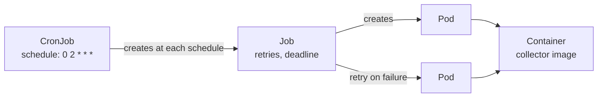
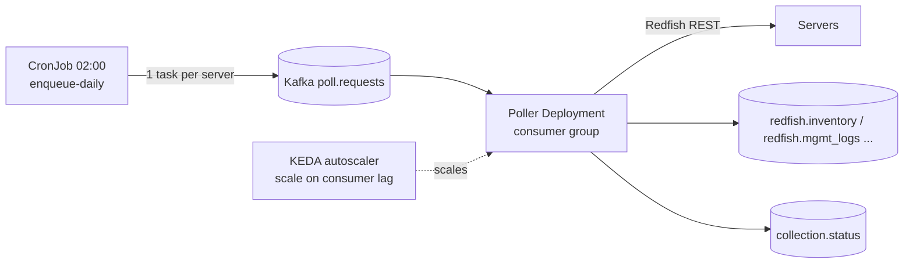
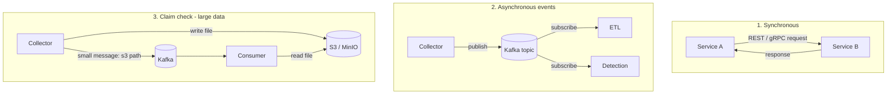
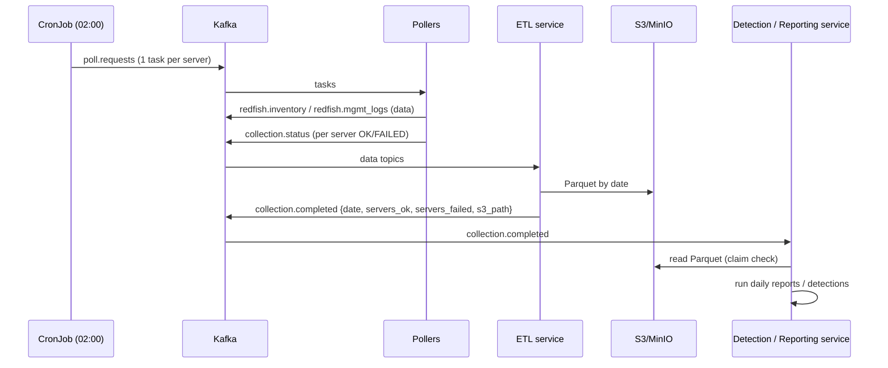

# Kubernetes Scheduling (CronJob) & Data Transfer Between Microservices

How we schedule **daily data collection** with **Kubernetes CronJobs** instead of Airflow, and how our microservices (MSAs) exchange data. The same approach works for the hourly detection run.

---

## 1. Why we moved from Airflow to Kubernetes CronJobs

| Airflow (open source, self-managed) | Kubernetes CronJob |
|---|---|
| Extra platform to run: scheduler, webserver, metadata DB, workers/executor, triggerer | Built into Kubernetes, nothing extra to run |
| Frequent upgrades, provider/plugin version conflicts, security patching | Upgraded with the cluster |
| Strong at **DAGs with dependencies** and passing data between tasks (XCom) | Best for **independent, time-based jobs** |
| Its own UI, backfill and retry features | Uses `kubectl`, Prometheus/Grafana, and Job retries |
| Separate access model to secure | Same RBAC, secrets, network policies and monitoring as all our services |

**Our reasons:**
1. Maintaining open-source Airflow (upgrades, DB, plugins, security fixes) was costly.
2. Our jobs are **simple schedules**: "collect data daily", "run detections hourly".
3. We had **no data passing between tasks**, so we didn't need DAGs or XCom.
4. Everything already ran on Kubernetes.

**In simple words:** we replaced a full-time train dispatcher (Airflow) with alarm clocks (CronJobs), because our trains don't depend on each other.

**When we'd go back to a workflow engine:** if jobs start depending on each other (A → B → C with branching), we'd use **Argo Workflows** (Kubernetes-native DAGs) or a managed Airflow (MWAA / Cloud Composer) rather than self-hosting.

---

## 2. Kubernetes CronJob basics



| Object | What it does | In simple words |
|---|---|---|
| **CronJob** | Creates a Job on a cron schedule | The alarm clock |
| **Job** | Runs pods until they succeed (with retries and a deadline) | The task to finish |
| **Pod** | The running container(s) | The worker doing the task |

### Key settings (interview favourites)

| Setting | Level | Meaning | Our value |
|---|---|---|---|
| `schedule` | CronJob | Cron expression | `"0 2 * * *"` (daily 02:00) |
| `timeZone` | CronJob | Time zone for the schedule (stable since K8s 1.27) | `"Etc/UTC"` |
| **`concurrencyPolicy`** | CronJob | `Allow` / **`Forbid`** (skip the new run if the previous one is still running) / `Replace` | `Forbid` |
| `startingDeadlineSeconds` | CronJob | If a run couldn't start in time (controller down), skip it after this many seconds | `600` |
| `successfulJobsHistoryLimit` / `failedJobsHistoryLimit` | CronJob | How many old Jobs to keep for debugging | `3` / `5` |
| `suspend` | CronJob | Pause the schedule without deleting it | `false` |
| **`backoffLimit`** | Job | How many times to retry failed pods | `3` |
| **`activeDeadlineSeconds`** | Job | Hard time limit for the whole Job (**our SLA guard**) | `3600` daily / `3300` hourly |
| `ttlSecondsAfterFinished` | Job | Auto-delete finished Jobs | `86400` |
| `parallelism` / `completions` / `completionMode: Indexed` | Job | Run N pods in parallel, each with an index (sharding) | e.g. `10` / `10` |
| `podFailurePolicy` | Job | Don't retry on certain exit codes (e.g. a config error) | exit code `2` → `FailJob` |
| `restartPolicy` | Pod | `OnFailure` or `Never` (Jobs can't use `Always`) | `Never` (a new pod per retry; easier to debug) |

---

## 3. Our daily collection CronJob (YAML)

```yaml
apiVersion: batch/v1
kind: CronJob
metadata:
  name: daily-server-collection
  namespace: telemetry
spec:
  schedule: "0 2 * * *"
  timeZone: "Etc/UTC"
  concurrencyPolicy: Forbid
  startingDeadlineSeconds: 600
  successfulJobsHistoryLimit: 3
  failedJobsHistoryLimit: 5
  jobTemplate:
    spec:
      backoffLimit: 3
      activeDeadlineSeconds: 3600            # whole run must finish in 1h, else Job fails → alert
      ttlSecondsAfterFinished: 86400
      podFailurePolicy:
        rules:
          - action: FailJob                   # bad config: retrying won't help
            onExitCodes: { operator: In, values: [2] }
      template:
        metadata:
          labels: { app: daily-server-collection }
        spec:
          restartPolicy: Never
          serviceAccountName: collector       # least-privilege RBAC
          securityContext: { runAsNonRoot: true }
          containers:
            - name: collector
              image: registry.local/collector:1.4.2     # pinned version, not :latest
              args: ["enqueue-daily", "--data-types", "inventory,mgmt_logs"]
              env:
                - name: KAFKA_BOOTSTRAP
                  valueFrom: { configMapKeyRef: { name: collector-config, key: kafka_bootstrap } }
                - name: VAULT_ROLE
                  value: collector
              resources:
                requests: { cpu: "250m", memory: "256Mi" }
                limits:   { cpu: "1",    memory: "512Mi" }
```

The hourly detection CronJob is the same shape with `schedule: "5 * * * *"` and `activeDeadlineSeconds: 3300`.

---

## 4. Two ways to do the actual work

### Option A – the CronJob only **enqueues**, long-running workers do the work (our choice)



- The CronJob runs for seconds: it reads the server registry and publishes one task per server to `poll.requests`.
- The **poller Deployment** (the same workers used for regular polling, see kafka.md §9) does the REST calls.
- **KEDA** scales the pollers on **Kafka consumer lag**: many pods at 02:00, back to the minimum afterwards.
- **Pros:**
  - reuses the existing pollers
  - natural retries through Kafka
  - one slow server doesn't block the job
  - easy to scale
- **Cons:** "is the daily run done?" needs tracking (see §6).

### Option B – the CronJob does the work itself (Indexed Job sharding)

```yaml
      completionMode: Indexed
      completions: 10
      parallelism: 10
```
- Each pod gets `JOB_COMPLETION_INDEX` (0–9) and handles the servers where `hash(server_id) % 10 == index`.
- **Pros:** simple and self-contained; the Job status = the run status.
- **Cons:** a fixed number of shards; one slow shard delays the whole Job; retrying a pod repeats its whole shard.

**In simple words:**
- **Option A:** the alarm clock writes job tickets, and a team that grows or shrinks as needed handles them.
- **Option B:** the alarm clock wakes 10 fixed workers, each with their own list.

---

## 5. Things a CronJob doesn't give you (and how we handle them)

| Airflow feature | Our replacement |
|---|---|
| `logical_date` / data interval | The app computes the window itself: **daily** = yesterday 00:00–24:00 UTC, **hourly** = previous full hour (`HourWindow.previous(now)` in this project). On K8s ≥ 1.28 the Job also carries the annotation `batch.kubernetes.io/cronjob-scheduled-timestamp` |
| Retries | Job `backoffLimit` + in-app retry with backoff for each REST call |
| Task timeout / SLA | `activeDeadlineSeconds` on the Job + the app's run-status table + watchdog |
| Backfill | Run a one-off Job with an explicit date: `kubectl create job collect-2026-11-10 --from=cronjob/daily-server-collection`, with the app accepting `--date` (or a small backfill Job template). Runs must be **idempotent** |
| Don't overlap runs | `concurrencyPolicy: Forbid` |
| UI / history | Grafana dashboards + `kubectl get jobs` + run-status table |
| DAG dependencies | Event-driven: a job publishes `*.completed` to Kafka and the next service reacts (see §7). If this grows → Argo Workflows |
| Catch up after downtime | `startingDeadlineSeconds` + app-level "missing run" check (like `backfill_missing` in this project) |

---

## 6. Monitoring and SLA

| Check | How |
|---|---|
| Job failed | `kube-state-metrics` → `kube_job_status_failed > 0` → alert |
| Job ran too long | `activeDeadlineSeconds` kills it → the Job fails → same alert |
| **Run never happened** (controller issue, suspended by mistake) | Alert when `time() - kube_cronjob_status_last_successful_time > 26h` (daily) / `> 70m` (hourly). This is our **dead-man's switch** |
| Work queue not draining (Option A) | Kafka **consumer lag** on `poll.requests` still > 0 an hour after the run → alert |
| Per-server failures | Collector writes `collection.status` (server, data type, OK/FAILED, reason). Dashboard + alert when the failure % passes a threshold |
| Logs | stdout → Fluent Bit → central logging (with `job-name` and `server_id` labels) |

Example Prometheus alert:
```yaml
- alert: DailyCollectionMissed
  expr: time() - kube_cronjob_status_last_successful_time{cronjob="daily-server-collection"} > 26 * 3600
  for: 10m
  labels: { severity: critical }
  annotations:
    summary: "Daily server collection has not succeeded in 26h"
```

---

## 7. Data transfer between microservices (MSAs)

Before, each service worked on its own and **no data moved between them**. When services do need to share data, these are the options:



| # | Method | When to use | Pros | Cons | In simple words |
|---|---|---|---|---|---|
| 1 | **REST / gRPC (synchronous)** | Queries that need an immediate answer (e.g. "get server details") | Simple, immediate | Tight coupling; if B is down, A fails; needs timeouts, retries, circuit breaker | A phone call: both must be available |
| 2 | **Kafka events (asynchronous)** – **our default** | Data flows (collected logs → ETL → detection), notifications | Decoupled; B can be down and catch up later; replay; many consumers | Eventual consistency; you need schemas and idempotent consumers | A message in a shared mailbox: read it when you're ready |
| 3 | **Claim check** (file in S3/MinIO + pointer message) | Big payloads (bulk inventory dumps, daily exports, ML datasets) | Keeps Kafka messages small; cheap storage | Two systems to manage; set file lifecycle/cleanup | Leave the parcel in a locker and text the locker number |
| 4 | **Shared database** | Avoid between services | Easy at first | Hidden coupling; schema changes break other services | Everyone writing in the same notebook |
| 5 | **Outbox pattern** | A service must update its DB **and** publish an event reliably | No "saved to DB but event lost" | Needs an outbox table + relay (or Debezium CDC) | Write the letter in your diary first, then a courier posts everything in the diary |
| 6 | **Shared volume (PVC ReadWriteMany)** | Rarely; only between pods of the same job | No network hop | Couples pods to storage; locking issues | A shared drawer |

### How our flow looks now (event-driven, no Airflow)



- **Choreography (what we use):** each service reacts to events, and there is no central controller. **In simple words:** dancers follow the music, not a director.
- **Orchestration (Airflow/Argo):** a central workflow tells each step when to run. Choose this when the flow has many steps, branches or human approvals.

### Rules for data transfer
1. **Contract first:** define message schemas (Avro/JSON Schema + Schema Registry) and version them (`schema_version`).
2. **Idempotent consumers:** every message has a stable `event_id`, and consumers dedupe, because Kafka delivery is at-least-once.
3. **Small messages:** use the claim check for anything over about 1 MB.
4. **Timeouts + retries + circuit breakers** on every synchronous call.
5. **Security:**
   - mTLS or service tokens between services
   - Kafka ACLs per topic
   - Kubernetes **NetworkPolicies** (allow only the expected service-to-service traffic)
   - secrets from Vault / External Secrets, never in images or ConfigMaps
6. **Traceability:** pass a `correlation_id` / `run_id` in headers and messages, so one daily run can be traced across all services.

---

## 8. Airflow vs Kubernetes CronJob vs Argo Workflows

| | Airflow (self-hosted) | **K8s CronJob** | Argo Workflows |
|---|---|---|---|
| Best for | Complex DAGs, data pipelines, backfills | **Simple scheduled jobs** | DAGs on Kubernetes (containers as steps) |
| Ops effort | High | **None extra** | Medium (controller + UI) |
| Dependencies between steps | Yes | No (use events) | Yes |
| Passing data between steps | XCom / external storage | Events / S3 | Artifacts (S3/MinIO) / parameters |
| Backfill | Built in | Manual Job with a date | Resubmit with parameters |
| UI | Rich | None (Grafana/kubectl) | Yes |
| Scaling | Executors (Celery/K8s) | Job parallelism / KEDA workers | Per-step pods |

**Our choice:** K8s CronJobs + Kafka events, because the jobs are independent, no workflow engine is needed and the ops cost is lowest. Move to Argo if real multi-step dependencies appear.

---

## 9. Interview Q&A

1. **Why did you move away from Airflow?** Self-hosted Airflow needed constant maintenance (scheduler, metadata DB, upgrades, plugins, security fixes). Our jobs were independent time-based collections with no data passing between tasks, so Kubernetes CronJobs covered it with no extra platform.
2. **CronJob vs Job vs Deployment?** A Deployment runs forever (services, workers). A Job runs to completion. A CronJob creates Jobs on a schedule.
3. **How do you stop overlapping runs?** `concurrencyPolicy: Forbid`.
4. **How do you enforce the SLA?** `activeDeadlineSeconds` on the Job, an alert on Job failure, plus a dead-man's-switch alert on `kube_cronjob_status_last_successful_time`.
5. **What if the run was missed (controller down)?** `startingDeadlineSeconds` controls whether it still starts late. The missing-run alert fires, and an idempotent backfill Job re-runs that date.
6. **How do you pass the run date without Airflow's `logical_date`?** The app computes the window (yesterday / previous hour), or reads the Job's scheduled-timestamp annotation. Backfills pass `--date` explicitly.
7. **How do you scale collection to thousands of servers?** The CronJob enqueues one task per server to Kafka, and a poller Deployment scales with KEDA on consumer lag. The alternative is an Indexed Job that shards by `hash(server_id) % N`.
8. **How do you avoid retrying a job that can never succeed?** `podFailurePolicy` with `FailJob` on specific exit codes (e.g. config errors), and `backoffLimit` for the rest.
9. **How do microservices exchange data?**
   - Kafka events by default (decoupled, replayable).
   - REST/gRPC for immediate queries.
   - Claim check (S3 + pointer) for big files.
   - Outbox pattern when a DB write and an event must both happen.
   - Never a shared database.
10. **Choreography vs orchestration?** Choreography: services react to events with no central brain (simple, loosely coupled). Orchestration: a workflow engine drives the steps (better for complex flows with branching and approvals).
11. **How do you make jobs safe to re-run?** Idempotent writes (upsert / dedupe on `event_id`, overwrite the date partition), with the run date as an explicit input.
12. **How do you secure CronJobs?**
    - a dedicated ServiceAccount with least-privilege RBAC
    - `runAsNonRoot`
    - pinned image tags
    - secrets from Vault/External Secrets
    - NetworkPolicies
    - resource limits
13. **How do you debug a failed run?** `kubectl get jobs -n telemetry`, `kubectl logs job/<name>`, and the failed Jobs kept by `failedJobsHistoryLimit`. Use central logs filtered by `run_id`, plus the `collection.status` topic/table for per-server errors.
