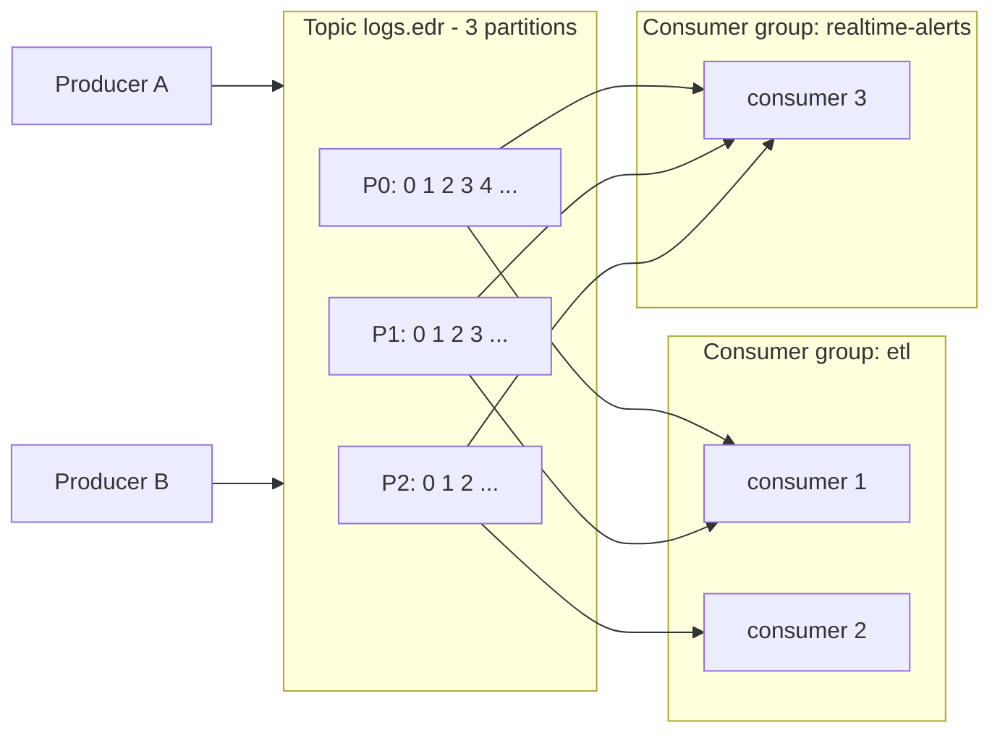
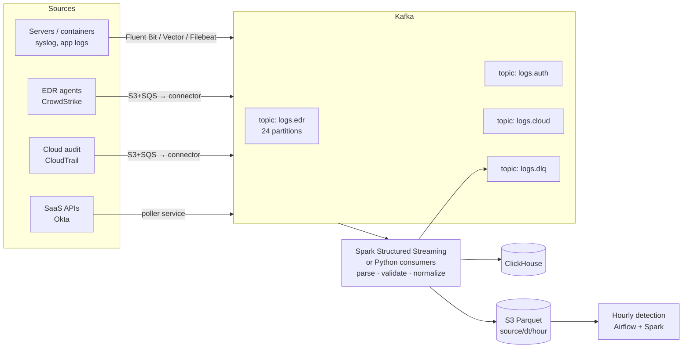

# Kafka – Basics, ETL Design & Interview Notes

How Kafka is used as the **Extract** step for the Hourly Detection Engine, plus the core concepts interviewers ask about.

---

## 1. What is Kafka?

A **distributed, durable, append-only log** for streaming events. Producers write events, Kafka stores them on disk (replicated), and many consumers read them at their own pace.

**In simple words:** a huge post-office inbox that never says "busy". Senders drop letters in, letters are kept for days, and many readers can each read the same letters using their own bookmark.

**Typical uses:** log/telemetry pipelines, event-driven microservices, CDC (database change streams), real-time analytics, feeding data lakes.

---

## 2. Core concepts

| Concept | What it is | In simple words |
|---|---|---|
| **Broker** | A Kafka server. A cluster = several brokers | One post-office building |
| **Topic** | A named stream of events (e.g. `logs.edr`) | A mailbox for one kind of letter |
| **Partition** | A topic is split into ordered, append-only logs; the unit of parallelism | Several checkout counters for the same shop |
| **Offset** | The position number of a message inside a partition | A bookmark / page number |
| **Key** | Decides which partition a message goes to (`hash(key) % partitions`) | All letters for the same house go to the same counter |
| **Producer** | Writes messages to topics | The sender |
| **Consumer** | Reads messages from topics | The reader |
| **Consumer group** | Consumers that share the partitions of a topic; each partition is read by exactly one consumer in the group | A team splitting the counters between them |
| **Replication factor** | Number of copies of each partition across brokers (usually 3) | Photocopies kept in different buildings |
| **Leader / follower** | One replica takes reads and writes (the leader); the others copy it | The main counter and its backups |
| **ISR (In-Sync Replicas)** | Followers that are fully caught up with the leader | Backups that are up to date |
| **Retention** | How long or how much data is kept (e.g. 7 days) | How long the post office stores letters |
| **Log compaction** | Keep only the latest value per key | Keep only the newest address for each person |
| **KRaft / ZooKeeper** | Cluster metadata management. KRaft (built in) replaces ZooKeeper in Kafka 3.x+/4.0 | The post office's head office |


Each **group** gets **all** the data. **Inside** a group, the partitions are divided between its consumers.

---

## 3. Ordering rules (common question)

- Order is guaranteed **only within a partition**, not across a whole topic.
- Need per-host or per-user order? Use that ID as the **key**, so all its events go to the same partition.
- More consumers than partitions → the extra consumers sit **idle**. Plan the partition count for future scale.
- Adding partitions later changes `hash(key) % n`, so keys move to different partitions and ordering breaks during the change. Choose the count up front.

---

## 4. Producer essentials

| Setting | Meaning | Typical |
|---|---|---|
| `acks=0` | Don't wait for any confirmation (fast, may lose data) | Rarely |
| `acks=1` | Leader confirmed (data lost if the leader dies before followers copy it) | Low-value data |
| **`acks=all`** | All in-sync replicas confirmed | **Default for important data** |
| `enable.idempotence=true` | No duplicates when the producer retries (default in new clients) | On |
| `linger.ms` / `batch.size` | Wait a few ms to send bigger batches → higher throughput | 5–50 ms |
| `compression.type` | `lz4` / `zstd` / `snappy` → less network and disk | `zstd` or `lz4` |
| `retries`, `delivery.timeout.ms` | Automatic retries for temporary errors | Defaults are good |

**Broker/topic side:** `min.insync.replicas=2` with replication factor 3 and `acks=all` → a write succeeds only if at least 2 copies have it.

```python
from confluent_kafka import Producer
import json

producer = Producer({
    "bootstrap.servers": "kafka:9092",
    "acks": "all",
    "enable.idempotence": True,
    "linger.ms": 20,
    "compression.type": "zstd",
})

def on_delivery(err, msg):
    if err:
        log.error("delivery failed: %s", err)

for event in read_agent_logs():
    producer.produce("logs.edr", key=event["host_id"], value=json.dumps(event), callback=on_delivery)
    producer.poll(0)          # serve delivery callbacks
producer.flush()              # wait for all in-flight messages before exit
```

---

## 5. Consumer essentials

| Setting | Meaning |
|---|---|
| `group.id` | Which consumer group this consumer belongs to |
| `auto.offset.reset` | Where to start when no offset is saved: `earliest` (replay all) or `latest` (only new) |
| `enable.auto.commit` | `False` = you commit offsets yourself after processing (safer) |
| `max.poll.interval.ms` | If you don't poll within this time, Kafka assumes the consumer is dead and **rebalances** |
| `max.poll.records` / batch size | How many records to process per loop |

**Rebalancing:** when a consumer joins, leaves or crashes, the partitions are reassigned within the group.
- **In simple words:** the team reshuffles which counters each person covers.
- Use **cooperative sticky** assignment to avoid a full "stop-the-world" pause.

**Consumer lag** = latest offset − committed offset, i.e. how far behind the reader is. It is **the key health metric**.

---

## 6. Delivery semantics

| Mode | How | Risk | When |
|---|---|---|---|
| At-most-once | Commit **before** processing | Lose messages on crash | Metrics where a gap is OK |
| **At-least-once** | Commit **after** processing/writing | Duplicates on crash/retry | **Most common.** Make the sink **idempotent** |
| Exactly-once (EOS) | Idempotent producer + **transactions** (read-process-write within Kafka), or Spark checkpoints + idempotent sink | More complex, slower | Payments, counts where duplicates matter |

**Interview line:** "At-least-once plus an idempotent sink gives effectively-once results. Our sink dedupes on `(source, event_id)`, and detection runs are re-runnable per hour."

---

## 7. Ecosystem

| Tool | Purpose |
|---|---|
| **Schema Registry** (Avro / Protobuf / JSON Schema) | Producers and consumers agree on the event format; compatibility rules stop breaking changes |
| **Kafka Connect** | Ready-made connectors: **source** (DB CDC with Debezium, S3, JDBC) and **sink** (S3, Elasticsearch, ClickHouse, Snowflake), no code |
| **Kafka Streams / ksqlDB** | Stream processing inside the Kafka ecosystem (joins, windows, aggregates) |
| **Spark Structured Streaming / Flink** | Large-scale stream processing; checkpoints for exactly-once into sinks |
| **MirrorMaker 2** | Copy topics between clusters/regions (DR) |
| Managed | AWS **MSK**, Confluent Cloud, Azure Event Hubs (Kafka API), Aiven |

---

## 8. ETL design: logs from many sources → hourly detections

### Big picture



### Why Kafka here
| Need | How Kafka helps | In simple words |
|---|---|---|
| Many sources writing at once | Producers write to topics in parallel | A huge inbox that never says "busy" |
| Sudden spikes | Kafka holds the messages on disk; consumers catch up | A dam that holds water during heavy rain |
| Consumer down | Messages are kept (retention); read later from the saved offset | A bookmark in a book |
| Re-process after a bug | Reset the offset and replay | Rewind the recording |
| Several readers | Separate consumer groups (ETL, real-time alerts, archive) | Many people reading the same newspaper |
| Scale | More partitions + consumers | More checkout counters |

### Is 100,000 logs OK?
- **If it means 100k events per second:** at about 1 KB each that is ~100 MB/s. A 3–6 broker cluster with 50–100 partitions per busy topic handles it.
- **If it means the challenge volume:** 50M rows/hour is only ~**14k events/s** per source.
- **If it means 100k sources/hosts:** lightweight agents (Fluent Bit/Vector) batch and compress the logs before sending.

### Steps
1. **Collect:** agents on hosts, connectors for S3/SQS sources, and pollers for SaaS APIs produce to **one topic per source**, keyed by `host_id` / `user_id`.
2. **Consume and normalize:** Spark Structured Streaming (or Python consumers):
   - parse and validate each record
   - rename and cast fields
   - convert times to UTC
   - send bad records to **`logs.dlq`**
3. **Write by event hour:** store events as Parquet in `s3://lake/normalized/source=…/dt=…/hour=…` and/or load into ClickHouse.
4. **Close the hour (watermark):** when wall-clock time is past hour + 5 min **and** consumer lag ≈ 0, write a `_SUCCESS` marker.
5. **Detect:** Airflow's sensor sees the marker and runs the hourly detection (single pass over the hour, as in this project).
6. **Late events:** they land in the old hour's folder. Re-run that hour (idempotent) or allow a lateness window.

### Python consumer (at-least-once, batched, DLQ)
```python
from confluent_kafka import Consumer, Producer
import json

consumer = Consumer({
    "bootstrap.servers": "kafka:9092",
    "group.id": "etl-edr",
    "enable.auto.commit": False,          # commit only after a successful write
    "auto.offset.reset": "earliest",
    "partition.assignment.strategy": "cooperative-sticky",
})
dlq = Producer({"bootstrap.servers": "kafka:9092"})
consumer.subscribe(["logs.edr"])

try:
    while True:
        msgs = consumer.consume(num_messages=5000, timeout=1.0)
        good = []
        for m in msgs:
            if m.error():
                continue
            try:
                good.append(normalize(json.loads(m.value())))
            except Exception as exc:                     # one bad record must not stop the stream
                dlq.produce("logs.dlq", m.value(), headers={"error": str(exc)[:200], "topic": m.topic()})
        if good:
            write_parquet_by_hour(good)                  # or store.add_events(good) in this project
        dlq.flush()
        if msgs:
            consumer.commit(asynchronous=False)          # after the write → at-least-once
finally:
    consumer.close()                                     # leave the group cleanly → fast rebalance
```

### Spark Structured Streaming (production scale)
```python
raw = (spark.readStream.format("kafka")
       .option("kafka.bootstrap.servers", "kafka:9092")
       .option("subscribe", "logs.edr")
       .option("startingOffsets", "latest")
       .option("maxOffsetsPerTrigger", 2_000_000)        # backpressure
       .load())

events = (raw.select(F.from_json(F.col("value").cast("string"), EDR_SCHEMA).alias("e"))
             .select("e.*")
             .withColumn("dt", F.to_date("event_time"))
             .withColumn("hour", F.hour("event_time")))

(events.writeStream.format("parquet")
   .option("path", "s3a://lake/normalized/source=edr/")
   .option("checkpointLocation", "s3a://lake/checkpoints/edr/")   # offsets + exactly-once file sink
   .partitionBy("dt", "hour")
   .trigger(processingTime="1 minute")
   .start())
```

### When NOT to use Kafka
- The source already drops hourly files into S3 (CloudTrail, CrowdStrike FDR). Read S3 directly using S3 event notifications to SQS.
- Low volume, a single consumer, and no replay needed → a simple queue (SQS) is enough.

---

## 9. Sizing and performance

- **Partitions:** start with the target throughput ÷ per-consumer throughput, then add headroom. For example, 100 MB/s ÷ 5 MB/s per consumer ≈ 20 → choose 24–48. Too many partitions means more memory, longer leader elections and slower rebalances.
- **Throughput tips:** batching (`linger.ms`), compression, bigger `fetch.min.bytes`, batch writes on the consumer side, and keep processing out of the poll thread if it's slow.
- **Message size:** keep messages small (KB). Put big payloads in S3 and send just a pointer.
- **Retention:** long enough to replay after the worst outage you plan for (e.g. 3–7 days).

---

## 10. Reliability & failure handling

| Problem | Handling |
|---|---|
| Broker dies | Replication factor 3, `min.insync.replicas=2`, `acks=all` → no data loss; a new leader is elected |
| Consumer crashes | Group rebalances; the new owner resumes from the last committed offset |
| Poison message (can't parse) | try/except per message → **DLQ topic** with error headers; continue |
| Slow downstream (S3/DB) | Consumer lag grows; Kafka buffers. Scale consumers (up to the partition count) or batch more |
| Duplicates | Idempotent producer + idempotent sink (dedupe key `event_id`) |
| Schema change breaks consumers | Schema Registry with BACKWARD compatibility |
| Region outage | MirrorMaker 2 / cluster linking to a DR cluster |

---

## 11. Security & monitoring

- **Security:**
  - **TLS** for encryption in transit
  - **SASL** (SCRAM / OAuth / mTLS) for authentication
  - **ACLs** so each service can read or write only its own topics
  - encryption at rest
  - no secrets in topic data
- **Monitor:**
  - **consumer lag** (most important; alert when it grows, since it threatens the 1-hour SLA)
  - under-replicated partitions
  - offline partitions
  - request latency
  - broker disk usage
  - producer error rate
  - DLQ rate
- **Tools:** Prometheus JMX exporter + Grafana, Burrow / Kafka Lag Exporter, Confluent Control Center, CloudWatch for MSK.

---

## 12. Kafka vs alternatives

| | Kafka | RabbitMQ | AWS SQS | AWS Kinesis | Pulsar |
|---|---|---|---|---|---|
| Model | Distributed log | Message broker (queues) | Managed queue | Managed stream | Log + queue |
| Replay | Yes (retention) | No (message gone once acked) | No | Yes (up to 365 days) | Yes |
| Many independent readers | Yes (consumer groups) | Via exchanges / copies | No (one consumer per message) | Yes | Yes |
| Ordering | Per partition | Per queue | FIFO queues only | Per shard | Per partition |
| Throughput | Very high | Medium | High | High (shard limits) | Very high |
| Best for | Event streaming, log pipelines, CDC | Task queues, complex routing | Simple decoupling | AWS-native streaming | Multi-tenant, geo-replication |

**In simple words:** RabbitMQ/SQS are a to-do list, where a task is gone once done. Kafka is a diary: entries stay, and anyone can read from any page.

---

## 13. Interview Q&A

1. **What is Kafka?** A distributed, replicated, append-only log used for high-throughput event streaming with replay.
2. **Topic vs partition?** A topic is the logical stream; partitions are its ordered, parallel pieces stored on brokers.
3. **How is ordering guaranteed?** Only within a partition. Use a key (e.g. `host_id`) so related events go to the same partition.
4. **What is a consumer group?** Consumers that share a topic's partitions. Each partition goes to one consumer per group, and different groups each get all the data.
5. **What if there are more consumers than partitions?** The extra consumers stay idle.
6. **What is an offset, and when do you commit it?** The position in a partition. Commit **after** processing for at-least-once.
7. **At-least-once vs exactly-once?** At-least-once can duplicate, so use an idempotent sink. Exactly-once uses idempotent producers + transactions, or Spark checkpoints with an idempotent sink.
8. **What do `acks=all` and `min.insync.replicas` do?** A write succeeds only when enough in-sync replicas have it, so a broker failure doesn't lose data.
9. **What is ISR?** In-Sync Replicas: followers fully caught up with the leader. Only these can become the new leader without data loss.
10. **What is a rebalance and why is it painful?** Partitions are reassigned when group membership changes, and processing pauses. Reduce it with cooperative-sticky assignment, static membership and fast processing per poll.
11. **What is consumer lag?** How far behind consumers are. It is the main alerting metric for pipelines with an SLA.
12. **How do you handle bad messages?** try/except per message, send to a DLQ topic with error details, continue, and monitor the DLQ rate.
13. **How do you choose the number of partitions?** Target throughput ÷ per-consumer throughput + headroom, keeping key ordering and future growth in mind.
14. **Log compaction?** Keeps only the latest value per key. Used for state/changelog topics (e.g. latest config per device).
15. **Why Schema Registry?** It enforces a contract between producers and consumers and blocks breaking changes.
16. **Kafka Connect vs a custom consumer?** Connect for standard sources/sinks (no code, scalable). A custom consumer when you need custom parsing or logic.
17. **Kafka vs SQS/RabbitMQ?** Kafka keeps data for replay and supports many independent readers with high throughput. Queues delete a message once it's consumed.
18. **How does Kafka fit the hourly detection design?** Kafka buffers and fans out the logs. The ETL normalizes them into hour partitions and closes the hour with a watermark, then Airflow runs the single-pass detection. Alert on consumer lag to protect the 1-hour SLA.
19. **ZooKeeper vs KRaft?** KRaft keeps the metadata inside Kafka (Raft consensus) and removes ZooKeeper. It is simpler to run and the default from Kafka 4.0.
20. **How do you make the pipeline secure?** TLS + SASL authentication, ACLs per topic, encryption at rest, secrets from a vault, and no sensitive data in plain text where avoidable.
