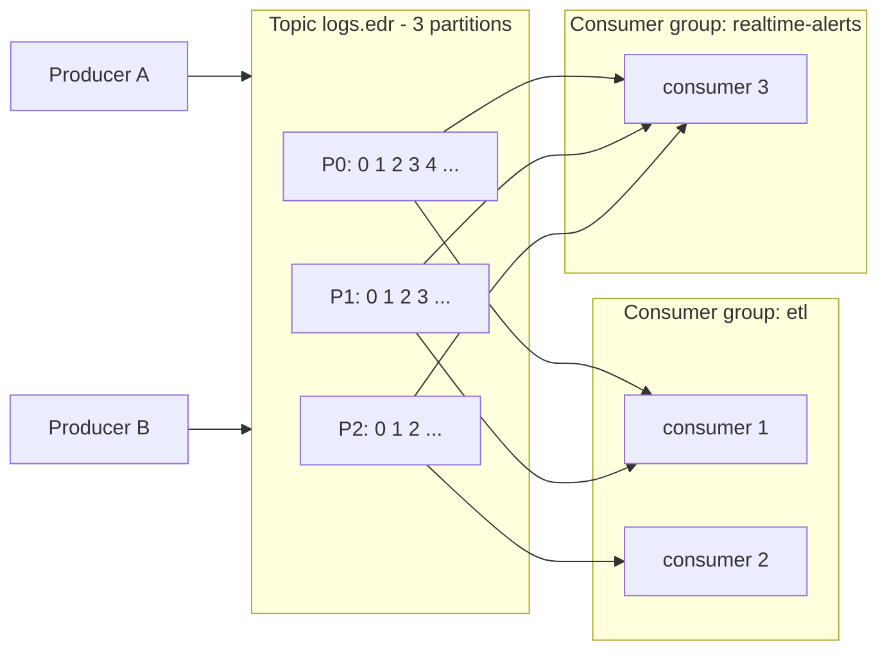
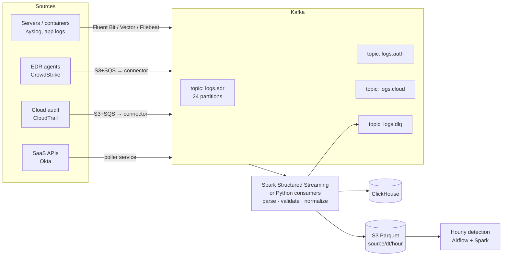
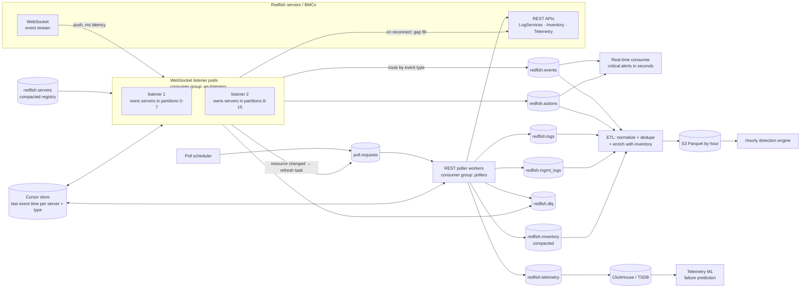
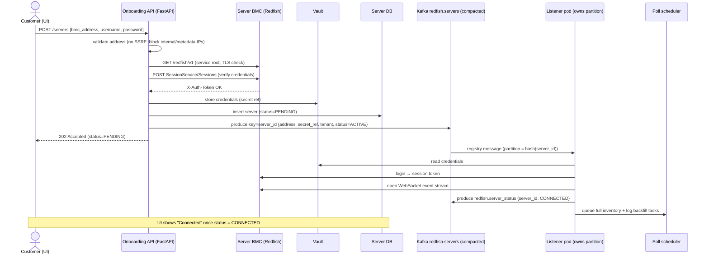

# Kafka – Basics, ETL Design & Interview Notes

How Kafka is used as the **Extract** step for the Hourly Detection Engine, plus the core concepts interviewers ask about.

---

## 1. What is Kafka?

A **distributed, durable, append-only log** for streaming events. Producers write events, Kafka stores them on disk (replicated), and many consumers read them at their own pace.

**In simple words:** a huge post-office inbox that never says "busy". Senders drop letters in, letters are kept for days, and many readers can each read the same letters using their own bookmark.

**Typical uses:** log/telemetry pipelines, event-driven microservices, CDC (database change streams), real-time analytics, feeding data lakes.

---

## 2. Core concepts

| Concept | What it is | In simple words |
|---|---|---|
| **Broker** | A Kafka server. A cluster = several brokers | One post-office building |
| **Topic** | A named stream of events (e.g. `logs.edr`) | A mailbox for one kind of letter |
| **Partition** | A topic is split into ordered, append-only logs; the unit of parallelism | Several checkout counters for the same shop |
| **Offset** | The position number of a message inside a partition | A bookmark / page number |
| **Key** | Decides which partition a message goes to (`hash(key) % partitions`) | All letters for the same house go to the same counter |
| **Producer** | Writes messages to topics | The sender |
| **Consumer** | Reads messages from topics | The reader |
| **Consumer group** | Consumers that share the partitions of a topic; each partition is read by exactly one consumer in the group | A team splitting the counters between them |
| **Replication factor** | Number of copies of each partition across brokers (usually 3) | Photocopies kept in different buildings |
| **Leader / follower** | One replica takes reads and writes (the leader); the others copy it | The main counter and its backups |
| **ISR (In-Sync Replicas)** | Followers that are fully caught up with the leader | Backups that are up to date |
| **Retention** | How long or how much data is kept (e.g. 7 days) | How long the post office stores letters |
| **Log compaction** | Keep only the latest value per key | Keep only the newest address for each person |
| **KRaft / ZooKeeper** | Cluster metadata management. KRaft (built in) replaces ZooKeeper in Kafka 3.x+/4.0 | The post office's head office |


Each **group** gets **all** the data. **Inside** a group, the partitions are divided between its consumers.

---

## 3. Ordering rules (common question)

- Order is guaranteed **only within a partition**, not across a whole topic.
- Need per-host or per-user order? Use that ID as the **key**, so all its events go to the same partition.
- More consumers than partitions → the extra consumers sit **idle**. Plan the partition count for future scale.
- Adding partitions later changes `hash(key) % n`, so keys move to different partitions and ordering breaks during the change. Choose the count up front.

---

## 4. Producer essentials

| Setting | Meaning | Typical |
|---|---|---|
| `acks=0` | Don't wait for any confirmation (fast, may lose data) | Rarely |
| `acks=1` | Leader confirmed (data lost if the leader dies before followers copy it) | Low-value data |
| **`acks=all`** | All in-sync replicas confirmed | **Default for important data** |
| `enable.idempotence=true` | No duplicates when the producer retries (default in new clients) | On |
| `linger.ms` / `batch.size` | Wait a few ms to send bigger batches → higher throughput | 5–50 ms |
| `compression.type` | `lz4` / `zstd` / `snappy` → less network and disk | `zstd` or `lz4` |
| `retries`, `delivery.timeout.ms` | Automatic retries for temporary errors | Defaults are good |

**Broker/topic side:** `min.insync.replicas=2` with replication factor 3 and `acks=all` → a write succeeds only if at least 2 copies have it.

```python
from confluent_kafka import Producer
import json

producer = Producer({
    "bootstrap.servers": "kafka:9092",
    "acks": "all",
    "enable.idempotence": True,
    "linger.ms": 20,
    "compression.type": "zstd",
})

def on_delivery(err, msg):
    if err:
        log.error("delivery failed: %s", err)

for event in read_agent_logs():
    producer.produce("logs.edr", key=event["host_id"], value=json.dumps(event), callback=on_delivery)
    producer.poll(0)          # serve delivery callbacks
producer.flush()              # wait for all in-flight messages before exit
```

---

## 5. Consumer essentials

| Setting | Meaning |
|---|---|
| `group.id` | Which consumer group this consumer belongs to |
| `auto.offset.reset` | Where to start when no offset is saved: `earliest` (replay all) or `latest` (only new) |
| `enable.auto.commit` | `False` = you commit offsets yourself after processing (safer) |
| `max.poll.interval.ms` | If you don't poll within this time, Kafka assumes the consumer is dead and **rebalances** |
| `max.poll.records` / batch size | How many records to process per loop |

**Rebalancing:** when a consumer joins, leaves or crashes, the partitions are reassigned within the group.
- **In simple words:** the team reshuffles which counters each person covers.
- Use **cooperative sticky** assignment to avoid a full "stop-the-world" pause.

**Consumer lag** = latest offset − committed offset, i.e. how far behind the reader is. It is **the key health metric**.

---

## 6. Delivery semantics

| Mode | How | Risk | When |
|---|---|---|---|
| At-most-once | Commit **before** processing | Lose messages on crash | Metrics where a gap is OK |
| **At-least-once** | Commit **after** processing/writing | Duplicates on crash/retry | **Most common.** Make the sink **idempotent** |
| Exactly-once (EOS) | Idempotent producer + **transactions** (read-process-write within Kafka), or Spark checkpoints + idempotent sink | More complex, slower | Payments, counts where duplicates matter |

**Interview line:** "At-least-once plus an idempotent sink gives effectively-once results. Our sink dedupes on `(source, event_id)`, and detection runs are re-runnable per hour."

---

## 7. Ecosystem

| Tool | Purpose |
|---|---|
| **Schema Registry** (Avro / Protobuf / JSON Schema) | Producers and consumers agree on the event format; compatibility rules stop breaking changes |
| **Kafka Connect** | Ready-made connectors: **source** (DB CDC with Debezium, S3, JDBC) and **sink** (S3, Elasticsearch, ClickHouse, Snowflake), no code |
| **Kafka Streams / ksqlDB** | Stream processing inside the Kafka ecosystem (joins, windows, aggregates) |
| **Spark Structured Streaming / Flink** | Large-scale stream processing; checkpoints for exactly-once into sinks |
| **MirrorMaker 2** | Copy topics between clusters/regions (DR) |
| Managed | AWS **MSK**, Confluent Cloud, Azure Event Hubs (Kafka API), Aiven |

---

## 8. ETL design: logs from many sources → hourly detections

### Big picture



### Why Kafka here
| Need | How Kafka helps | In simple words |
|---|---|---|
| Many sources writing at once | Producers write to topics in parallel | A huge inbox that never says "busy" |
| Sudden spikes | Kafka holds the messages on disk; consumers catch up | A dam that holds water during heavy rain |
| Consumer down | Messages are kept (retention); read later from the saved offset | A bookmark in a book |
| Re-process after a bug | Reset the offset and replay | Rewind the recording |
| Several readers | Separate consumer groups (ETL, real-time alerts, archive) | Many people reading the same newspaper |
| Scale | More partitions + consumers | More checkout counters |

### Is 100,000 logs OK?
- **If it means 100k events per second:** at about 1 KB each that is ~100 MB/s. A 3–6 broker cluster with 50–100 partitions per busy topic handles it.
- **If it means the challenge volume:** 50M rows/hour is only ~**14k events/s** per source.
- **If it means 100k sources/hosts:** lightweight agents (Fluent Bit/Vector) batch and compress the logs before sending.

### Steps
1. **Collect:** agents on hosts, connectors for S3/SQS sources, and pollers for SaaS APIs produce to **one topic per source**, keyed by `host_id` / `user_id`.
2. **Consume and normalize:** Spark Structured Streaming (or Python consumers):
   - parse and validate each record
   - rename and cast fields
   - convert times to UTC
   - send bad records to **`logs.dlq`**
3. **Write by event hour:** store events as Parquet in `s3://lake/normalized/source=…/dt=…/hour=…` and/or load into ClickHouse.
4. **Close the hour (watermark):** when wall-clock time is past hour + 5 min **and** consumer lag ≈ 0, write a `_SUCCESS` marker.
5. **Detect:** Airflow's sensor sees the marker and runs the hourly detection (single pass over the hour, as in this project).
6. **Late events:** they land in the old hour's folder. Re-run that hour (idempotent) or allow a lateness window.

### Python consumer (at-least-once, batched, DLQ)
```python
from confluent_kafka import Consumer, Producer
import json

consumer = Consumer({
    "bootstrap.servers": "kafka:9092",
    "group.id": "etl-edr",
    "enable.auto.commit": False,          # commit only after a successful write
    "auto.offset.reset": "earliest",
    "partition.assignment.strategy": "cooperative-sticky",
})
dlq = Producer({"bootstrap.servers": "kafka:9092"})
consumer.subscribe(["logs.edr"])

try:
    while True:
        msgs = consumer.consume(num_messages=5000, timeout=1.0)
        good = []
        for m in msgs:
            if m.error():
                continue
            try:
                good.append(normalize(json.loads(m.value())))
            except Exception as exc:                     # one bad record must not stop the stream
                dlq.produce("logs.dlq", m.value(), headers={"error": str(exc)[:200], "topic": m.topic()})
        if good:
            write_parquet_by_hour(good)                  # or store.add_events(good) in this project
        dlq.flush()
        if msgs:
            consumer.commit(asynchronous=False)          # after the write → at-least-once
finally:
    consumer.close()                                     # leave the group cleanly → fast rebalance
```

### Spark Structured Streaming (production scale)
```python
raw = (spark.readStream.format("kafka")
       .option("kafka.bootstrap.servers", "kafka:9092")
       .option("subscribe", "logs.edr")
       .option("startingOffsets", "latest")
       .option("maxOffsetsPerTrigger", 2_000_000)        # backpressure
       .load())

events = (raw.select(F.from_json(F.col("value").cast("string"), EDR_SCHEMA).alias("e"))
             .select("e.*")
             .withColumn("dt", F.to_date("event_time"))
             .withColumn("hour", F.hour("event_time")))

(events.writeStream.format("parquet")
   .option("path", "s3a://lake/normalized/source=edr/")
   .option("checkpointLocation", "s3a://lake/checkpoints/edr/")   # offsets + exactly-once file sink
   .partitionBy("dt", "hour")
   .trigger(processingTime="1 minute")
   .start())
```

### When NOT to use Kafka
- The source already drops hourly files into S3 (CloudTrail, CrowdStrike FDR). Read S3 directly using S3 event notifications to SQS.
- Low volume, a single consumer, and no replay needed → a simple queue (SQS) is enough.

---

## 9. Our scenario: Redfish servers → Kafka (WebSocket + REST)

Our servers expose **Redfish**. There are two ways to get data:
- **WebSocket event stream:** the server **pushes** events and server actions (power on/off, reset, firmware update, hardware faults) the moment they happen.
- **REST polling:** we **pull** logs, inventory and telemetry on a schedule.

Both paths feed the **same Kafka cluster**, using one topic per data type, keyed by `server_id`.

**In simple words:** the WebSocket is a live phone call where the server tells you immediately. REST polling is checking your mailbox every few minutes for everything else.

### 9.1 Redfish data → Kafka topics

| Data | Redfish source (typical) | How | Topic | Topic type |
|---|---|---|---|---|
| **Server actions & events** (power state, reset, alerts, status changes) | Event stream over **WebSocket** (EventService) | **Push**, real time | `redfish.events`, `redfish.actions` | Normal, 7 days |
| **Event / system logs** (full record, gap fill) | `/redfish/v1/Systems/{id}/LogServices/{log}/Entries` | Poll 5–15 min + **on reconnect** | `redfish.logs` | Normal, 7–30 days |
| **Management / audit logs** (logins, config changes) | `/redfish/v1/Managers/{id}/LogServices/{log}/Entries` | Poll 5–15 min | `redfish.mgmt_logs` | Normal, 30 days |
| **Inventory** (CPU, memory, storage, NICs, firmware) | `/Systems/{id}`, `/Systems/{id}/Processors`, `/Memory`, `/Storage`, `/Chassis/{id}`, `/UpdateService/FirmwareInventory` | Poll daily **+ when a "resource changed" event arrives** | `redfish.inventory` | **Compacted** (latest per server) |
| **Telemetry** (temperature, power, fans, CPU) | `/redfish/v1/TelemetryService/MetricReports/{id}`, Chassis environment/power/thermal resources | Poll 30 s–5 min, or metric-report events if pushed | `redfish.telemetry` | Normal, 1–3 days |
| Server registry (which servers exist and who listens to them) | Our CMDB / onboarding API | On change | `redfish.servers` | **Compacted** |
| Failures (bad payloads, servers that keep failing) | – | – | `redfish.dlq` | Normal |

Tips:
- Use **`ETag` + `If-None-Match`** on inventory calls. If nothing changed, the server returns **304** with no body, which saves bandwidth and API load.
- **Event-driven inventory:** when the WebSocket says a resource changed (e.g. a DIMM was replaced or firmware updated), queue an immediate inventory refresh for **that server only** instead of polling all servers often.

### 9.2 Architecture



There are **two paths**:
- **Fast path:** a real-time consumer on `redfish.events`/`redfish.actions` alerts within seconds, e.g. unexpected power-off or a critical hardware fault.
- **Batch path:** the hourly detection engine runs correlation and pattern rules, e.g. "3 correctable memory errors on the same DIMM within 1 hour" or "config change outside the maintenance window".

### 9.3 WebSocket listener design

| Concern | Solution | In simple words |
|---|---|---|
| **Thousands of long-lived connections** | `asyncio` + `websockets` (one pod can hold thousands of idle sockets) | One receptionist can keep many phone lines open |
| **Which pod listens to which server?** | Listener pods form a **consumer group** on the compacted `redfish.servers` topic. Each pod opens sockets for the servers in **its** partitions. On rebalance, it closes the sockets it lost and opens the ones it gained | Kafka hands out the phone lists; if a receptionist leaves, the others take their calls |
| **Authentication** | Redfish **session token** (`X-Auth-Token` from SessionService); re-login when it expires; credentials from a vault; TLS verification on | Show your badge, renew it when it expires |
| **Dead connection detection** | Ping/pong heartbeat (e.g. every 20 s); treat silence as disconnected | "Are you still there?" |
| **Reconnect** | Exponential backoff **+ jitter** (avoid all pods reconnecting at the same moment after a network blip) | Don't all redial at once |
| **Events missed while disconnected** | On every reconnect, **gap fill**: read LogService entries since the last event time seen, and publish them | After a dropped call, ask "what did I miss?" |
| **Duplicates (WebSocket + gap fill both deliver an event)** | Stable `event_id = hash(server_id + MessageId + timestamp)` used by both paths; downstream dedupes on it | Same letter delivered twice → shred the copy |
| **Low latency** | Produce immediately with a small `linger.ms` (≈5 ms) and `acks=all` | Post the letter right away |
| **Bursts (event storm)** | Bounded `asyncio.Queue` between the socket reader and the producer; Kafka absorbs the burst | A waiting room in front of the counter |
| **Silent server** | Track "last message time" per server; the watchdog alerts if a server has been silent too long | If a friend who always texts goes quiet, check on them |

### 9.4 Listener sketch

```python
import asyncio, hashlib, json, random, ssl
import websockets
from confluent_kafka import Producer

producer = Producer({"bootstrap.servers": "kafka:9092", "acks": "all",
                     "enable.idempotence": True, "linger.ms": 5})
ACTION_TYPES = {"ResourceAdded", "ResourceRemoved", "ResourceUpdated"}

def event_id(server_id: str, ev: dict) -> str:
    ts = ev.get("EventTimestamp") or ev.get("Created", "")
    return hashlib.sha256(f"{server_id}|{ev.get('MessageId')}|{ts}".encode()).hexdigest()

def publish(server_id: str, ev: dict) -> None:
    topic = "redfish.actions" if ev.get("EventType") in ACTION_TYPES else "redfish.events"
    msg = {"event_id": event_id(server_id, ev), "server_id": server_id,
           "event_time": ev.get("EventTimestamp"), "payload": ev}
    producer.produce(topic, key=server_id, value=json.dumps(msg))
    producer.poll(0)

async def listen(server, cursors, stop: asyncio.Event) -> None:
    delay = 1.0
    while not stop.is_set():
        try:
            token = await login(server)                                  # Redfish SessionService
            async with websockets.connect(server.ws_url, ssl=ssl.create_default_context(),
                                          additional_headers={"X-Auth-Token": token},
                                          ping_interval=20, ping_timeout=20) as ws:
                await gap_fill(server, since=await cursors.get(server.id))   # missed while offline
                delay = 1.0
                async for raw in ws:
                    for ev in json.loads(raw).get("Events", []):
                        publish(server.id, ev)
                        cursors.mark(server.id, ev.get("EventTimestamp"))    # persisted after producer.flush()
        except (OSError, websockets.ConnectionClosed) as exc:
            log.warning("ws %s disconnected: %s", server.id, exc)
        await asyncio.sleep(min(60.0, delay) * random.uniform(0.5, 1.5))     # backoff + jitter
        delay *= 2

async def gap_fill(server, since: str | None) -> None:
    """Read LogService entries newer than `since` and publish them with the same event_id scheme."""
    for entry in await fetch_log_entries(server, since):                    # paginated REST call
        publish(server.id, {"MessageId": entry["MessageId"], "EventTimestamp": entry["Created"],
                            "Message": entry.get("Message"), "Severity": entry.get("Severity")})
```
- `additional_headers` is for `websockets` ≥ 14; older versions use `extra_headers`.
- Field names can vary by vendor and Redfish version. Map them in one `normalize()` function.

### 9.5 Customer adds a server → how the WebSocket gets established

The onboarding API **does not** open the WebSocket itself. It publishes the new server to the compacted `redfish.servers` topic, and the listener pod that **owns that server's partition** opens the connection.

**In simple words:** reception registers the new guest in the book, and the floor manager responsible for that floor goes and sets up the room.



**Steps**
1. **Customer adds the server:** they enter the BMC address and credentials in the UI, which calls `POST /servers`.
2. **The API validates first:**
   - **SSRF protection:** the customer controls the address, so block private and cloud-metadata IPs (e.g. `169.254.169.254`) and internal ranges. Allow only the customer's approved network.
   - **Redfish check:** `GET /redfish/v1` (service root) with a TLS certificate check.
   - **Credentials:** log in through the Redfish SessionService. A bad password fails right away with a clear error.
3. **Store and publish:**
   - The password goes to a **vault**. The DB and Kafka keep only a `secret_ref`.
   - The server is saved in the DB with `status = PENDING`.
   - An `ACTIVE` record is published to `redfish.servers`:
     ```json
     {"server_id": "SGH123", "tenant_id": "acme", "bmc_address": "10.20.1.15",
      "secret_ref": "vault://redfish/acme/SGH123", "status": "ACTIVE", "version": 1}
     ```
   - The API returns `202 Accepted`; the connection happens asynchronously.
4. **The owning listener connects:**
   - Kafka routes the record to a partition using `hash(server_id) % partitions`. The one pod that owns that partition in the `ws-listeners` group receives it.
   - That pod reads the credentials from the vault, logs in, and opens the WebSocket. If your Redfish implementation needs an EventService subscription first, it creates that before connecting.
   - It publishes `CONNECTED` (or `FAILED` + reason) to `redfish.server_status`. The UI shows the status.
5. **Initial data:** a **full inventory** and **log backfill** task is queued on `poll.requests`, so the new server has complete data from the start. Regular polling then starts on its normal schedule.

**Listener side (sketch)**
```python
consumer = Consumer({"bootstrap.servers": "kafka:9092", "group.id": "ws-listeners",
                     "enable.auto.commit": False, "auto.offset.reset": "earliest",
                     "partition.assignment.strategy": "cooperative-sticky"})
connections: dict[str, asyncio.Task] = {}

def on_revoke(consumer, partitions):
    for server_id in servers_in(partitions):          # another pod now owns these servers
        connections.pop(server_id).cancel()          # close their WebSockets

consumer.subscribe(["redfish.servers"], on_revoke=on_revoke)

async def registry_loop():
    while True:
        msg = await asyncio.to_thread(consumer.poll, 1.0)
        if msg is None or msg.error():
            continue
        server_id = msg.key().decode()
        if msg.value() is None:                       # tombstone = server removed
            if task := connections.pop(server_id, None):
                task.cancel()
        else:
            server = Server.from_json(msg.value())
            if old := connections.pop(server_id, None):
                old.cancel()                          # config/credential change → reconnect
            if server.status == "ACTIVE":
                connections[server_id] = asyncio.create_task(listen(server, cursors, stop))
        consumer.commit(msg, asynchronous=False)
```
Because the topic is **compacted** and read from `earliest`, a **restarted or new pod** replays the latest record for every server in its partitions and reopens all the sockets automatically.

**The whole server lifecycle uses the same topic**

| Customer action | Message on `redfish.servers` | Listener does |
|---|---|---|
| Add server | `{..., status: ACTIVE}` | Login → open WebSocket → backfill |
| Change credentials / address | Same key, new `version` | Close the socket, reconnect with the new details |
| Pause monitoring | `status: PAUSED` | Close the socket, keep the record |
| Remove server | **Tombstone** (key with `null` value) | Close the socket, delete the session/subscription; compaction later deletes the record |
| Listener pod dies | (nothing) | Rebalance: another pod gets the partition, replays the registry, reconnects |

### 9.6 Interview one-liner
"Our servers expose Redfish.
- **Events and server actions** come over a WebSocket stream in real time. Async listener pods, which share servers through a Kafka consumer group, publish them to `redfish.events` and `redfish.actions` keyed by server ID.
- **Logs, inventory and telemetry** are polled over REST by a separate poller group and published to their own topics. Inventory is a compacted topic, and it is refreshed on resource-change events.
- **Missed events:** on every reconnect we gap-fill from LogService, and a stable event ID removes the duplicates.
- **Two consumers:** a real-time consumer raises critical alerts in seconds, and the hourly engine runs the correlation rules.
- **Onboarding:** when a customer adds a server, the API checks the address (SSRF), the TLS certificate and the credentials, stores the secret in a vault, and publishes an `ACTIVE` record to the compacted `redfish.servers` topic. The listener pod that owns that partition opens the WebSocket and reports `CONNECTED`. Updates and removals are new records or tombstones on the same topic."

---

## 10. Sizing and performance

- **Partitions:** start with the target throughput ÷ per-consumer throughput, then add headroom. For example, 100 MB/s ÷ 5 MB/s per consumer ≈ 20 → choose 24–48. Too many partitions means more memory, longer leader elections and slower rebalances.
- **Throughput tips:** batching (`linger.ms`), compression, bigger `fetch.min.bytes`, batch writes on the consumer side, and keep processing out of the poll thread if it's slow.
- **Message size:** keep messages small (KB). Put big payloads in S3 and send just a pointer.
- **Retention:** long enough to replay after the worst outage you plan for (e.g. 3–7 days).

---

## 11. Reliability & failure handling

| Problem | Handling |
|---|---|
| Broker dies | Replication factor 3, `min.insync.replicas=2`, `acks=all` → no data loss; a new leader is elected |
| Consumer crashes | Group rebalances; the new owner resumes from the last committed offset |
| Poison message (can't parse) | try/except per message → **DLQ topic** with error headers; continue |
| Slow downstream (S3/DB) | Consumer lag grows; Kafka buffers. Scale consumers (up to the partition count) or batch more |
| Duplicates | Idempotent producer + idempotent sink (dedupe key `event_id`) |
| Schema change breaks consumers | Schema Registry with BACKWARD compatibility |
| Region outage | MirrorMaker 2 / cluster linking to a DR cluster |

---

## 12. Security & monitoring

- **Security:**
  - **TLS** for encryption in transit
  - **SASL** (SCRAM / OAuth / mTLS) for authentication
  - **ACLs** so each service can read or write only its own topics
  - encryption at rest
  - no secrets in topic data
- **Monitor:**
  - **consumer lag** (most important; alert when it grows, since it threatens the 1-hour SLA)
  - under-replicated partitions
  - offline partitions
  - request latency
  - broker disk usage
  - producer error rate
  - DLQ rate
- **Tools:** Prometheus JMX exporter + Grafana, Burrow / Kafka Lag Exporter, Confluent Control Center, CloudWatch for MSK.

---

## 13. Kafka vs alternatives

| | Kafka | RabbitMQ | AWS SQS | AWS Kinesis | Pulsar |
|---|---|---|---|---|---|
| Model | Distributed log | Message broker (queues) | Managed queue | Managed stream | Log + queue |
| Replay | Yes (retention) | No (message gone once acked) | No | Yes (up to 365 days) | Yes |
| Many independent readers | Yes (consumer groups) | Via exchanges / copies | No (one consumer per message) | Yes | Yes |
| Ordering | Per partition | Per queue | FIFO queues only | Per shard | Per partition |
| Throughput | Very high | Medium | High | High (shard limits) | Very high |
| Best for | Event streaming, log pipelines, CDC | Task queues, complex routing | Simple decoupling | AWS-native streaming | Multi-tenant, geo-replication |

**In simple words:** RabbitMQ/SQS are a to-do list, where a task is gone once done. Kafka is a diary: entries stay, and anyone can read from any page.

---

## 14. Interview Q&A

1. **What is Kafka?** A distributed, replicated, append-only log used for high-throughput event streaming with replay.
2. **Topic vs partition?** A topic is the logical stream; partitions are its ordered, parallel pieces stored on brokers.
3. **How is ordering guaranteed?** Only within a partition. Use a key (e.g. `host_id`) so related events go to the same partition.
4. **What is a consumer group?** Consumers that share a topic's partitions. Each partition goes to one consumer per group, and different groups each get all the data.
5. **What if there are more consumers than partitions?** The extra consumers stay idle.
6. **What is an offset, and when do you commit it?** The position in a partition. Commit **after** processing for at-least-once.
7. **At-least-once vs exactly-once?** At-least-once can duplicate, so use an idempotent sink. Exactly-once uses idempotent producers + transactions, or Spark checkpoints with an idempotent sink.
8. **What do `acks=all` and `min.insync.replicas` do?** A write succeeds only when enough in-sync replicas have it, so a broker failure doesn't lose data.
9. **What is ISR?** In-Sync Replicas: followers fully caught up with the leader. Only these can become the new leader without data loss.
10. **What is a rebalance and why is it painful?** Partitions are reassigned when group membership changes, and processing pauses. Reduce it with cooperative-sticky assignment, static membership and fast processing per poll.
11. **What is consumer lag?** How far behind consumers are. It is the main alerting metric for pipelines with an SLA.
12. **How do you handle bad messages?** try/except per message, send to a DLQ topic with error details, continue, and monitor the DLQ rate.
13. **How do you choose the number of partitions?** Target throughput ÷ per-consumer throughput + headroom, keeping key ordering and future growth in mind.
14. **Log compaction?** Keeps only the latest value per key. Used for state/changelog topics (e.g. latest config per device).
15. **Why Schema Registry?** It enforces a contract between producers and consumers and blocks breaking changes.
16. **Kafka Connect vs a custom consumer?** Connect for standard sources/sinks (no code, scalable). A custom consumer when you need custom parsing or logic.
17. **Kafka vs SQS/RabbitMQ?** Kafka keeps data for replay and supports many independent readers with high throughput. Queues delete a message once it's consumed.
18. **How does Kafka fit the hourly detection design?** Kafka buffers and fans out the logs. The ETL normalizes them into hour partitions and closes the hour with a watermark, then Airflow runs the single-pass detection. Alert on consumer lag to protect the 1-hour SLA.
19. **ZooKeeper vs KRaft?** KRaft keeps the metadata inside Kafka (Raft consensus) and removes ZooKeeper. It is simpler to run and the default from Kafka 4.0.
20. **How do you make the pipeline secure?** TLS + SASL authentication, ACLs per topic, encryption at rest, secrets from a vault, and no sensitive data in plain text where avoidable.

### Redfish-specific
21. **Why use both WebSocket and REST polling?** The WebSocket gives real-time events and actions with no delay. REST is needed for full logs, inventory and telemetry, and to fill gaps after a disconnect.
22. **How do you scale thousands of WebSocket connections?** Async I/O (`asyncio`) in each pod, with servers spread across listener pods by a Kafka consumer group on a compacted server-registry topic. A rebalance moves connections when a pod dies.
23. **How do you avoid losing events when a WebSocket drops?** Heartbeats detect it, reconnect with backoff + jitter, then gap-fill from LogService since the last event time. A stable event ID removes the duplicates.
24. **How do you keep inventory fresh without hammering the servers?** A compacted topic, `ETag`/`If-None-Match` (304 when unchanged), a daily full refresh, plus an immediate refresh triggered by resource-change events.
25. **Real-time vs hourly – why both?** Real-time catches critical single events in seconds. Hourly batch rules catch patterns across many events (counts, trends, correlations with inventory).
26. **Kafka message key for Redfish data?** `server_id`, so all data for a server stays in order on one partition and the registry, events and inventory line up per server.
27. **How is the WebSocket established when a customer adds a server?**
    - The API validates the address (SSRF), TLS certificate and credentials, stores the secret in a vault, and publishes an `ACTIVE` record to the compacted `redfish.servers` topic.
    - The listener pod that owns that partition logs in, opens the WebSocket, reports `CONNECTED`, and triggers inventory/log backfill.
    - Removal = a tombstone record. Pod failure = rebalance + replay of the compacted topic.
