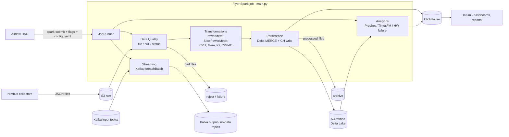

# Flyer — PySpark Design & Interview Preparation Guide

> Derived from reading the Flyer codebase (batch ETL, streaming, analytics, persistence).
> Sections marked **(inferred)** are deductions from the code/config, not something the repo states explicitly.
> Section 12 lists real weaknesses found in the code — be ready to discuss them honestly in an interview.

---

## 1. 60-second elevator pitch

Flyer is a **PySpark + Delta Lake platform** that turns raw server telemetry (collected by *Nimbus* into S3) into a **refined, partitioned Delta Lake** and pushes the result to **ClickHouse** for the *Datum* analytics/UI service.

- **Batch ETL** (Airflow-triggered `spark-submit`): file checks → data-quality checks → transformations (hourly roll-ups, 5-min buckets, CO₂/energy/cost enrichment) → Delta `MERGE` (idempotent insert-only) → ClickHouse JDBC write → archive/reject/failure folders.
- **Structured Streaming** (Kafka → `foreachBatch` → Kafka): near-real-time power & utilization reporting with bounded micro-batches, a dead-letter path and checkpointing on S3.
- **Analytics**: time-series forecasting (Prophet legacy, **Google TimesFM** foundation model) and hardware-failure scoring (RandomForest), run as distributed `mapPartitions` over per-device series.
- **Operational model**: one Docker image, one `main.py` entry point, behaviour selected by CLI flags + **LaunchDarkly feature flags**; per-metric ETL can be driven by a YAML/JSON config passed from Airflow.

Key numbers to remember: PySpark **3.5.8**, Scala **2.13**, JDK **17**, Python **3.12**, Delta **3.3.2**, hadoop-aws **3.3.4**, default read repartition **32**, streaming repartition **16**, `maxOffsetsPerTrigger` **5000**, trigger **30 s**, ClickHouse batch **50 000** rows, max **16** CH write partitions.

---

## 2. High-level architecture



**Layers (medallion-style):** Raw (S3 JSON) → Refined (Delta, partitioned) → Serving (ClickHouse). Raw files are *moved* (process → archive / reject / failure) so a folder is a work queue, not just storage.

### Repository map

| Area | Path | Responsibility |
|---|---|---|
| Entry point | [main.py](../main.py) | Builds `SparkSession` (Delta ext., S3A, dynamic partition overwrite, schema auto-merge), inits LaunchDarkly, calls `JobRunner` |
| CLI flags | [Core/Config/flag_parser.py](../Core/Config/flag_parser.py) | `-c class`, `-m module`, `-fp path`, `-s3 bucket`, `-s3w`, `-stream`, `-tnf` (train & forecast), `-dq`, `-cyml` |
| Orchestration | [Core/Services/JobRunner.py](../Core/Services/JobRunner.py) | Dispatches: HW-failure / streaming / forecast / batch ETL |
| Config | [Core/Config/config.py](../Core/Config/config.py) | Schemas, paths, topics, env-overridable tunables |
| Source read | [Core/Services/processor.py](../Core/Services/processor.py), [Core/Services/sourceReader.py](../Core/Services/sourceReader.py), [Core/Utility/dataframe_utils.py](../Core/Utility/dataframe_utils.py) | Explicit-schema JSON read with inference fallback, repartition |
| S3 helpers | [Core/Utility/archive_s3.py](../Core/Utility/archive_s3.py) | Distributed bulk move/copy via RDD `mapPartitions` |
| Data quality | [DataQuality/QualityChecks/](../DataQuality/QualityChecks) | `fileCheck`, `nullCheck`, `statusCheck` (+ unused `schemaCheck`, `thresholdCheck`) |
| Transformations | [DataTransformation/Transformations/](../DataTransformation/Transformations) | One class per metric, plus `YamlEtlOrchestrator` |
| Persistence | [DataPersistence/Persistence/s3Persistence.py](../DataPersistence/Persistence/s3Persistence.py), [DBPersistence.py](../DataPersistence/Persistence/DBPersistence.py) | Delta merge, ClickHouse JDBC writes, fan-out tables |
| Streaming | [DataStreaming/Streaming/](../DataStreaming/Streaming) | Kafka consumers/producers, 3 streaming apps |
| Analytics | [DataAnalytics/Analytics/](../DataAnalytics/Analytics), [DataAnalytics/HWPrediction/](../DataAnalytics/HWPrediction) | Forecasting & failure scoring |
| Backfill | [ch_backfill.py](../ch_backfill.py) | Re-populate ClickHouse from Delta by date range |
| Image | [Dockerfile](../Dockerfile) | Chainguard Spark 3.5.8 / JDK17 / Py3.12 + Delta, S3A, Kafka, ClickHouse JARs, pre-downloaded TimesFM model |

---

## 3. Runtime & deployment design

- **Image**: `spark:v3.5.8-sc2.13-jdk17-py3.12` (Chainguard, minimal/hardened). Connector JARs (`hadoop-aws`, `aws-java-sdk-bundle`, `delta-spark_2.13`, `delta-storage`, `spark-sql-kafka`, `kafka-clients`, `commons-pool2`, `clickhouse-jdbc`) are baked into `/opt/spark/jars` — **no `--packages` resolution at runtime** (faster, reproducible, works offline/air-gapped).
- **TimesFM model is downloaded at image-build time** (before app files are copied) so the Docker layer is cached and executors don't hit the internet at job start.
- **Multi-stage Dockerfile**: `dev` (runtime) → `tests` (adds pytest deps, sample data). Unit tests run inside the image (`make unit-tests`).
- **S3 auth**: local env uses access keys + path-style endpoint (MinIO-like); non-local uses `WebIdentityTokenCredentialsProvider` → IAM-role-for-service-account on Kubernetes/EKS **(inferred)**.
- **Executor sizing is NOT in this repo** — `spark.executor.memory`, `memoryOverhead`, cores and instances come from the external job spec (Airflow/K8s). The code only *reads* `SPARK_EXECUTOR_INSTANCES` (default 24) and `SPARK_EXECUTOR_CORES` (default 3) to size partitions. Be explicit about this in an interview.
- **Spark session config** set in code: Delta SQL extension + catalog, `spark.databricks.delta.schema.autoMerge.enabled=true`, `spark.sql.sources.partitionOverwriteMode=dynamic`, S3A impl. [datastreamer.py](../datastreamer.py) additionally sets `spark.sql.shuffle.partitions=8` and graceful shutdown.
- **Feature flags** ([feature_flags.py](../feature_flags.py), LaunchDarkly): gate entire jobs (`T_20240410_4447_DATA_TRANSFORMATION_BOOL`), individual transformations, ClickHouse writes, OPTIMIZE, streaming, TimesFM vs Prophet, etc. → safe progressive rollout and instant kill-switch without redeploying.

---

## 4. Batch ETL — step by step

Entry: `main.py → JobRunner.jobExecutor()`. Dispatch order: *metric LD gate → HW-failure → streaming → train/forecast → batch ETL*.

### 4.1 Ingestion
1. (Optional, YAML mode) `move_input_file` **copies raw files to a `process/` prefix** so new arrivals during the run don't get mixed in (snapshot isolation on a file-queue).
2. `s3_path_has_files` uses boto3 `list_objects_v2` and breaks on the first real file → cheap emptiness check **before** starting Spark work. If empty, job exits (`PATH_NOT_FOUND`).
3. Read with an **explicit schema** (`config.power_telemetry_schema` / `other_telemetry_schema`), `multiline=true`, `recursiveFileLookup=true`; on failure **fall back to schema inference**. Then `.repartition(32)` (configurable via `df_partitions`).
   - Why explicit schema: skips the inference pass (an extra full scan), gives type safety and stable columns.
   - Why repartition: telemetry files are small/uneven and `multiline` JSON is **not splittable** (one file = one task), so a shuffle re-balances downstream work.
   - `input_file_name()` is added as `filename` so a bad record can be traced back to the file to reject.

### 4.2 Data Quality ([qualityAnalyser.py](../DataQuality/QualityChecks/qualityAnalyser.py))
| Check | How | On failure |
|---|---|---|
| `fileCheck` | boto3 listing, not Spark: non-`.json` or zero-byte | files moved to `reject/DataQuality/fileCheck` |
| `nullCheck` | `when(...)` flag on `application_customer_id`, `platform_customer_id`, `device_id`; `collect()` of distinct bad filenames (small) | files moved to reject |
| `statusCheck` | rows with `status == False` (no-data / opted-out reports) are enriched, written to `NoDataReasons/<class>` Delta and ClickHouse `no_data_reason`, then the **source files are deleted** | DQ status = False → DataFrame discarded, transformation re-reads folder |

`dft` (the validated DataFrame) is handed to the transformation ("using same spark DF from DQ") to avoid re-parsing when everything is clean.

### 4.3 Transformations (one class per metric)
- **PowerMeter / SlowPowerMeter** ([PowerMeter.py](../DataTransformation/Transformations/PowerMeter.py)):
  - add missing optional columns as `lit(None)` (schema tolerance for older collectors),
  - `explode(data.PowerDetail)` → one row per sample, `to_timestamp(...).cast("long")`,
  - drop null timestamp/value, **bucket to 5-min** via `floor(ts/300)*300`,
  - `dropDuplicates([acid, device_id, datetime, timeRangeEnd])` (idempotency within a batch),
  - **CO₂ / energy-cost enrichment**: small CSV lookup (`sustainability_location_factors.csv`) **broadcast-joined** on lower-cased country/state, with `left_anti` joins for fallback tiers (country-only, then global default 0.4412665 kg/kWh),
  - self-join with a `groupBy(...).max(metric_time)` to stamp `location_date/inventory_date`,
  - normalise blanks to `UNKNOWN` / `Not configured`, compute `energy_consumption`, `energy_cost`, `carbon_emission`,
  - add `batchtime = HH_00_00` (several runs per day become separate partitions).
- **CPU / Memory / IO / CPU-interconnect** ([CpuUtilization.py](../DataTransformation/Transformations/CpuUtilization.py)): explode `MetricValues`, **hourly roll-up** with `groupBy(..., datetime, timeRangeEnd).agg(avg,min,max)`, plus optional **5-min DataFrame** ([utility.py](../DataTransformation/Utility/utility.py) `build_5min_utilization_df`) written to a sibling Delta path.
- **YamlEtlOrchestrator**: generic, **config-driven ETL** (ingestion → ordered `transformation` ops → `deltalake` → `persistence` → `archive`). Operations are looked up by name with `getattr(utility, op)` — a small plugin pattern: add a function, reference it in YAML.
- `getLastCollectionDate` builds a tiny **metadata DataFrame** (last collection time per device/metric) written as Parquet and to ClickHouse.

### 4.4 Persistence ([s3Persistence.py](../DataPersistence/Persistence/s3Persistence.py))
1. **Capture `min(Insertiontime)`** *before* the merge (used later to read back only newly inserted rows).
2. Optionally `repartition(*partition_columns)` so each `(date, pcid, acid, deviceid)` maps to one task → **one Parquet file per partition** (avoids the small-files problem).
3. If the Delta table doesn't exist (or `only_insert`): `df.write.partitionBy(...).format("delta").mode("overwrite")`.
4. Else **`MERGE ... WHEN NOT MATCHED THEN INSERT *`** (insert-only ⇒ idempotent re-runs). The merge condition is **pruned**: `delta_lake.date >= min_date-1 AND delta_lake.pcid IN (...)` plus key equality. The driver `collect()`s the (small) distinct `pcid` list and `first()`s the min date to build it.
5. `ConcurrentAppendException` → retry with exponential backoff (see bug in §12).
6. **Read-back → ClickHouse**: `write_ch_from_delta` reads Delta filtered by `date >= …` and (for batchtime-partitioned classes) `Insertiontime >= batch_min`, so ClickHouse only gets *new* rows (no duplicates on reruns).
7. Optional `OPTIMIZE` (flag-gated) for compaction.

### 4.5 ClickHouse write ([DBPersistence.py](../DataPersistence/Persistence/DBPersistence.py))
- JDBC `append` with `batchsize=50000`, 3 retries with 5 s back-off.
- `_target_ch_partitions`: `rows // 50000 + 1`, **hard-capped at 16** — bounds concurrent connections and protects the ClickHouse server's memory (materialised-view triggers).
- **Fan-out**: one DataFrame is projected into several tables (`server_inventory`, `server_location`, `server_details`, `powermeter`, `no_data_reason`) in dependency order via `CH_FANOUT_TABLES` + `CH_COLUMNS_MAP`.
- **Paced batched writes** for tables that trigger MVs: `cache()` → `count()` (materialise) → `randomSplit` into N batches → `coalesce` → write → `sleep(3s)` between batches. The cache is *required for correctness*: `randomSplit` on an uncached, non-deterministic lineage could give overlapping/missing rows between re-evaluations.
- Null handling (`fill_nulls_for_ch`) so ClickHouse non-Nullable columns don't reject rows.

### 4.6 Archive / reject / failure ([archive_s3.py](../Core/Utility/archive_s3.py))
- `s3_bulk_move`: list keys with boto3 on the driver → `sc.parallelize(keys, 30)` → `mapPartitions(s3_move_rdd)` → `count()` as the action. **S3 copy/delete runs in parallel on executors**, with **one boto client per partition** (not per file) and a **generator** (constant memory). Target path reconstructs `date=/pcid=/acid=/deviceid=` from the filename.
- Success → `archive/…`, DQ failure → `reject/…`, transformation failure → `failure/…`. Folder state = job state.

---

## 5. Streaming design

Three Structured Streaming apps (all **Kafka source → `foreachBatch` → Kafka sink**):

| App | File | Purpose |
|---|---|---|
| Generic power stream (PowerMeter / SlowPowerMeter opt-in) | [generic_power_stream.py](../DataStreaming/Streaming/generic_power_stream.py) | Transform on-demand reports, discard expired data, publish refined JSON, send no-data to a topic |
| Opt-out slow power meter | [opt_out_slowpower_meter.py](../DataStreaming/Streaming/opt_out_slowpower_meter.py) | Compute *delta* vs refined Delta table (join / left-anti), "zero-delta" handling |
| Utilization stream | [utilization_stream.py](../DataStreaming/Streaming/utilization_stream.py) | CPU/Mem/IO/CPU-IC: 5-min and hourly DataFrames per metric, averaged per bucket, published to two topics |

Design choices worth citing:
- **Rate limiting**: `maxOffsetsPerTrigger=5000` + `processingTime=30s` → *bounded micro-batch size* ⇒ predictable memory (OOM protection) and back-pressure by design.
- **`foreachBatch`** lets us reuse the *batch* DataFrame transformations unchanged inside the stream and write to multiple sinks.
- **Checkpoint on S3** per stream (`.../checkpoint_reporting_<bucket>/<class>`) → exactly-once *offset* tracking, restart-safe. `startingOffsets=latest`, `failOnDataLoss=false` (tolerates retention-expired offsets rather than crashing).
- **persist/unpersist discipline**: inside each micro-batch the DataFrame used by several actions is `persist()`ed and always `unpersist()`ed in a `finally` — otherwise cached blocks accumulate across batches and evict/fill memory.
- **Dead-letter**: on exception the batch is *not* re-raised (so offsets commit and the query survives); `dead_letter_batch` pushes the batch to the no-data topic with an error reason. Trade-off: at-most-once for poison batches, but the stream never stalls.
- **Kafka output shaping**: many rows per server are folded into **one newline-delimited JSON message** (`concat_ws("\n", collect_list(to_json(struct)))`) → fewer, larger Kafka messages (consumer-side ClickHouse `JSONEachRow` expands them).
- `isEmpty()` / `head()` are used instead of `count()` for emptiness checks (short-circuit, much cheaper).
- Stateless processing only (no watermarks / stateful aggregations) ⇒ **no state-store growth risk**.

---

## 6. Analytics design

### 6.1 Forecasting — two engines behind a flag (`T_20260106_101226_FORECAST_TIMESFM_BOOL`)
**Data prep** ([datareader.py](../DataAnalytics/Analytics/datareader.py)):
1. Read a **train-data cache** (Parquet, `date`-partitioned) + only the **incremental Delta slice** since the cache's max date → avoids re-reading 90 days of history every run.
2. `union` → `persist(MEMORY_AND_DISK)` → materialise with `count()` → `dropDuplicates()`.
3. Keep devices with enough history (≈ threshold × required hours/days) using `groupBy().agg(count, countDistinct)` + **`broadcast` join** of the qualifying device IDs.
4. `repartition(devices // executor_cores, "device_id")` so a device's rows are co-located; persist again; unpersist the intermediates with `blocking=True`.
5. Write the incremental slice back to the cache for the next run.

**TimesFM path** ([timesfm_inference.py](../DataAnalytics/Analytics/timesfm_inference.py), [timesfm_predictor.py](../DataAnalytics/Analytics/timesfm_predictor.py)):
- Resample hourly → N-hourly with a `window()` aggregation.
- `groupBy(device).agg(collect_list(struct(datetime, y)))` → **one row per device with its whole series**.
- `grouped_df.rdd.mapPartitions(process_device_batch_on_executor)` → **one predictor (model load) per partition**, batched inference, results flattened to forecast rows. Model is loaded once per partition, not per device.
- `createDataFrame(result_rdd, schema)` → `cache()` → `count()` → `coalesce(records / 50000 + 1)` → ClickHouse JDBC.
- Inside the executor: explicit `del` of big numpy arrays + **`gc.collect()` in `finally`** (see §10).
- Skip devices already inferred recently (read from ClickHouse) to save compute.

**Prophet path** ([PowerForecast.py](../DataAnalytics/Analytics/PowerForecast.py), [modeltraining.py](../DataAnalytics/Analytics/modeltraining.py)): `df.rdd.map(...)` chain per device (preprocess → partition train/test → train (warm start from **broadcast** models / MLflow) → forecast → error → expand) — pure-Python per-device pipeline on RDDs.

### 6.2 Hardware-failure scoring ([hw_inference.py](../DataAnalytics/HWPrediction/hw_inference.py))
Feature-flag/ACID-gated batch job: list IML metric files → build features from ClickHouse aggregates + inventory → score with a pre-trained RandomForest → write results to ClickHouse. The model package is shipped to executors with `sc.addPyFile`. Currently scoring is assembled and executed **on the driver** (see §12).

---

## 7. Cross-cutting design patterns

| Pattern | Where | Why |
|---|---|---|
| Feature flags (LaunchDarkly) | everywhere | Gradual rollout, kill-switch, per-cluster behaviour |
| Config-driven pipeline | `ETL.yaml`, `YamlEtlOrchestrator`, `CH_COLUMNS_MAP`, `CH_FANOUT_TABLES` | Onboard a metric with config, not code |
| Dynamic class loading | `__import__(moduleName)` + `getattr(className)` | Single runner for all metrics |
| Folder-as-state | process / archive / reject / failure | Observable, re-runnable, auditable |
| Idempotent writes | insert-only Delta MERGE + `dropDuplicates` + Insertiontime read-back | Safe re-runs / backfills |
| Bounded resources | `maxOffsetsPerTrigger`, CH partition cap, batched writes with sleep | Protect Spark *and* downstream ClickHouse |
| Error codes | `ErrorEnum.HPE_GL_COMPUTE_OPS_27000xx` per layer (DQ, DT, persistence, streaming, Kafka) | Fast triage from logs |
| Fail loudly | `JobRunner` re-raises → Spark job fails → Airflow retries/alerts | No silent data loss |
| Executor-side logging & lazy model load | predictors | Debuggable distributed Python |

---

## 8. Spark fundamentals — mapped to Flyer

### 8.1 Narrow vs wide transformations
- **Narrow** (no shuffle): `select`, `filter`, `withColumn`, `explode`, `union`, `coalesce`, `mapPartitions`.
- **Wide** (shuffle = stage boundary): `repartition`, `groupBy.agg`, `distinct`, `dropDuplicates`, non-broadcast `join`, `window` aggregations, `orderBy`.
- Flyer wide ops: `repartition(32)`, hourly `groupBy`, `dropDuplicates`, `distinct` (pcid list), self-join on `groupBy(max)`, `randomSplit`, `groupBy(device).collect_list`.

### 8.2 Actions vs transformations (lazy evaluation)
Nothing runs until an **action**: `count`, `collect`, `first/head/take`, `show`, `write`, `isEmpty`, `foreach`. Each action = a new **job** that re-executes the lineage back to the source (or to the last cached/checkpointed point).

### 8.3 Partitions, tasks, stages
- Partitions = unit of parallelism and of memory per task. Too few → OOM/skew; too many → scheduler overhead and tiny files.
- `spark.sql.shuffle.partitions` default 200; AQE (default **on** in Spark 3.2+, so on in 3.5.8) coalesces small shuffle partitions and can split skewed joins and switch to broadcast at runtime.
- Flyer sizing rules: read → 32; streaming → 16; analytics → `devices // cores`; ClickHouse → `rows/50k+1` capped 16; Delta write → repartition by partition columns.

### 8.4 `repartition` vs `coalesce`
- `repartition(n[, cols])`: full shuffle, can increase/decrease, balances data, can co-locate keys.
- `coalesce(n)`: narrow, only *decreases*, no shuffle, may create uneven partitions. Used right before JDBC writes (limit connections) and metadata (`coalesce(1)`, tiny data only).

### 8.5 Broadcast join
Small side (≤ `spark.sql.autoBroadcastJoinThreshold`, 10 MB default; or explicit `broadcast()`) is shipped to every executor → no shuffle of the big side. Flyer: `location_df` (CSV lookup) and `filtered_device_ids`. Risk: broadcasting something that grows → driver/executor OOM.

---

## 9. Lineage — what it is, good vs bad, with Flyer examples

### 9.1 Definition
**Lineage** = the logical DAG of transformations that produced a dataset (RDD lineage / Spark plan). Spark uses it for (a) **fault tolerance** — recompute lost partitions from the parent, (b) **lazy optimisation** — Catalyst optimises the whole plan, (c) **recomputation** — every action re-walks it unless cached/checkpointed. Inspect with `df.explain(True)`, `rdd.toDebugString()`, Spark UI → SQL/DAG tab.

### 9.2 What makes lineage **good**
1. **Short and narrow** — few stages, few shuffles; transformations fused into one stage (pipelining).
2. **Declarative DataFrame/SQL ops** so Catalyst can push down filters/projections, prune partitions/columns and pick join strategies.
3. **Deterministic** — same input ⇒ same output, so recomputation after failure is safe.
4. **Materialised at the right points** — `cache/persist` for data reused by ≥2 actions; `checkpoint` to *truncate* very long/iterative lineages.
5. **One action per logical result** (or a single write), not many incidental actions.
6. **Early filtering / pruning** — filter on partition columns before heavy work.
7. **Plan stays inspectable** (`explain`) and stable between runs.

### 9.3 What makes lineage **bad**
1. **Very long** chains (hundreds of `withColumn`/`union` calls, iterative loops) → huge plan, slow analysis/optimisation, driver OOM or `StackOverflowError`, expensive recompute on failure.
2. **Recomputing an expensive branch repeatedly** (reused DataFrame, no cache, many actions) → re-reads S3 + re-parses JSON + re-shuffles each time.
3. **Non-deterministic steps** (`current_timestamp()`, `rand`, `randomSplit`, `monotonically_increasing_id`, unordered `limit`, Python UDFs with side effects) in a recomputed lineage → inconsistent results between actions or after executor loss.
4. **Wide dependencies everywhere** (shuffle-heavy chains) → failure of one executor forces recompute of many parent partitions.
5. **Lineage broken into an opaque node** (Python RDD ↔ DataFrame round-trips) → Catalyst can't optimise across it.
6. **Debug actions left in production** (`show`, `count` for logging).
7. **Caching used as a substitute for design** (cache everything → memory pressure/eviction).

### 9.4 Good lineage — examples in Flyer ✅
| Example | Why it's good |
|---|---|
| Explicit schema on `spark.read.json(...)` | No inference pass; plan starts clean |
| `select` of only needed columns right after `explode` | Column pruning, narrower rows through shuffles |
| Single-pass hourly `groupBy(...).agg(avg,min,max)` | One shuffle yields three aggregates |
| `broadcast(location_df)` joins | Avoids shuffling the big telemetry side |
| Delta read filtered on `date` / `Insertiontime` / `pcid` | **Partition pruning + data skipping** |
| Merge condition with `date >= min-1 AND pcid IN (...)` | Prunes Delta files scanned by `MERGE` |
| `cache(); count(); … randomSplit …; unpersist()` in `execute_ch_writes` | Materialise once; makes `randomSplit` deterministic; explicit release |
| `persist` in `foreachBatch` + `unpersist` in `finally` | Reuse inside a micro-batch, no cross-batch leak |
| `isEmpty()` / `head()` instead of `count()` | Short-circuiting actions |
| `repartition(*partition_cols)` before partitioned write | One file per partition → no small-file explosion |
| `mapPartitions` with per-partition setup (boto client, TimesFM model) | Amortise expensive init; generators keep memory flat |
| Train-data cache (Parquet) + incremental Delta slice | Short lineage: don't recompute 90 days each run |
| [ch_backfill.py](../ch_backfill.py) comment "avoid `.count()` per partition — it rescans S3" + single cache+count | Deliberate removal of repeated scans |

### 9.5 Bad / risky lineage — examples in Flyer ⚠️
| Example | Problem | Better |
|---|---|---|
| [processor.py](../Core/Services/processor.py): `df.count()` and `df.select(...).distinct().count()` only for logging | 2 extra full scans of multiline JSON on S3 per run | Remove, or cache once, or use accumulators / Spark UI metrics |
| DQ → transformation reuse `dft` **without `cache()`**; `nullCheck`, `statusCheck`, transformation, persistence each trigger actions | Raw JSON is re-read, re-parsed and re-shuffled for every action | `persist(MEMORY_AND_DISK)` the validated DF once, `unpersist` after write |
| In `persistence()`: `min(Insertiontime).first()`, `distinct pcid .collect()`, `min(date).first()`, then the merge itself — all against the same uncached lineage | 4 recomputations of the whole transformation DAG (3 scalar actions + merge) | Compute the three scalars in **one** `agg`, and cache the DF before them |
| `current_timestamp()` / `current_date()` baked into `Insertiontime`/`date` + recomputation | Value is re-evaluated **per action**, so lineage isn't deterministic. Works today only because the later value is `>=` the captured minimum | Compute once (Python `datetime` literal via `lit`) or materialise before first action |
| Loops of `withColumn` (UNKNOWN / Not-configured normalisation) and many chained `withColumn` in [PowerMeter.py](../DataTransformation/Transformations/PowerMeter.py) | Each `withColumn` adds a projection; catalyst collapses most, but long chains slow analysis | One `select([...])` or `withColumns({...})` (Spark 3.3+) |
| `df.show(20)` / `df.show(2)` in transformations | An action in production; recomputes lineage | Guard behind debug flag or remove |
| `df` joined to the same lookup three ways (`inner`, `leftanti`, `leftanti`+join) then `union` | Source DF evaluated 3× | Single join with `left` + `when/coalesce` tiers, or cache `df` |
| [ch_backfill.py](../ch_backfill.py) `unionByName` in a loop over each date | Lineage depth = number of days; planning cost grows | One `read.parquet(basePath, paths…)` / filter on partition column |
| `createDataFrame(rdd)` after `df.rdd.map…` (Prophet, TimesFM) | Catalyst can't see inside; Python pickling both ways | Prefer `applyInPandas` / `mapInPandas` / pandas UDF (Arrow) where possible |
| Comment "Cache to **break lineage**" in [timesfm_inference.py](../DataAnalytics/Analytics/timesfm_inference.py) | **`cache()` does not truncate lineage.** It avoids recomputation, but if an executor is lost Spark still recomputes from the parents | Use `checkpoint()` / `localCheckpoint()` (or write to Parquet and re-read) to actually cut lineage |

### 9.6 `cache` vs `persist` vs `checkpoint`
| | Stores | Lineage kept? | Survives executor loss? | Cost |
|---|---|---|---|---|
| `cache()` | `MEMORY_AND_DISK` for DataFrames (`MEMORY_ONLY` for RDDs) on executors | **Yes** | Recomputed from lineage | Cheap |
| `persist(level)` | Chosen storage level (`MEMORY_AND_DISK`, `DISK_ONLY`, `*_SER`, `OFF_HEAP`) | **Yes** | Recomputed (unless `_2` replication) | Cheap |
| `localCheckpoint()` | Executor storage | **No (truncated)** | **No** (loses data if executor dies) | Cheap, less safe |
| `checkpoint()` | Reliable storage (S3/HDFS) | **No (truncated)** | **Yes** | Extra write+read |

Rule of thumb: **cache** for reuse, **checkpoint** for iterative / very deep lineages or before an expensive non-deterministic stage. Always `unpersist()` when done (Flyer uses `blocking=True` in analytics to guarantee memory is freed before the next heavy step). Remember caching is lazy — it only populates on the first action (hence Flyer's `cache(); count()` idiom).

---

## 10. Garbage collection & memory model

### 10.1 Why GC matters in Spark
PySpark = **two runtimes per executor**: the **JVM** (Spark engine, shuffle, Delta/Parquet, JDBC) and **Python worker processes** (UDFs, `mapPartitions`, pandas, numpy, TimesFM). Both are garbage-collected, and both can fail with OOM.

JVM objects: Spark creates huge numbers of short-lived objects (rows, deserialised records, hash-map entries, boxed values). Without GC the heap would fill; with GC you pay **pauses**:
- **Stop-the-world pauses** → tasks stall, executor misses heartbeats (`spark.executor.heartbeatInterval`, `spark.network.timeout`) → driver marks it **lost** → stage retries → cascading recompute.
- **GC overhead limit exceeded** / `java.lang.OutOfMemoryError: Java heap space` when >98 % of time is spent in GC reclaiming <2 % heap.
- **Cached data lives in the old generation**: a large `MEMORY_ONLY` cache of Java objects makes full GCs long. Serialised/columnar caches (DataFrame cache is columnar compressed) and `MEMORY_AND_DISK` reduce this.
- JDK 17 defaults to **G1GC**; typical Spark advice: keep G1, tune `-XX:InitiatingHeapOccupancyPercent=35`, `-XX:+UseStringDeduplication`, avoid heaps > ~32 GB (compressed oops), enable `-Xlog:gc*` and read it in the Spark UI (**GC time** column on the Stages/Executors tab; > ~10 % of task time is a red flag).

### 10.2 Spark's unified memory (per executor JVM)
```
Container memory (K8s limit) = spark.executor.memory (JVM heap)
                             + spark.executor.memoryOverhead   (off-heap, Python workers, JNI, thread stacks, netty)
                             + spark.executor.pyspark.memory   (optional cap for Python)
JVM heap − 300 MB reserved
  └─ spark.memory.fraction (0.6) = Unified region
       ├─ Storage  (cached blocks)       ┐ spark.memory.storageFraction 0.5 (soft boundary,
       └─ Execution (shuffle/join/sort/agg buffers) ┘  execution can evict storage)
  └─ remaining 0.4 = user memory (your objects, UDF structures, metadata)
```
Consequences: caching too much starves execution (more spill); heavy Python work needs **overhead**, not heap.

### 10.3 Where Flyer deals with GC explicitly
- [timesfm_predictor.py](../DataAnalytics/Analytics/timesfm_predictor.py): in the `finally` of batched inference, large numpy/quantile arrays are `del`-ed and **`gc.collect()`** is called, with the comment "CRITICAL: Force cleanup of large arrays after partition completes".
  - **Why**: Python frees by reference counting but arrays referenced from reference cycles (frames, exceptions/tracebacks, closures, pandas objects) are only freed by the **cyclic GC**, which runs lazily. A Python worker is **reused across tasks**, so un-freed arrays from partition *N* are still resident when partition *N+1* loads → memory creeps up until the **container is OOM-killed (exit 137)** — which looks like "executor lost", not a Java OOM.
  - The model object itself is intentionally kept (loaded once per worker/partition).
- `unpersist(blocking=True)` after heavy stages in analytics → deterministic release of storage memory *before* the next stage (instead of relying on lazy cleanup by the `ContextCleaner`/GC).
- `persist()/unpersist()` + `finally` in streaming → prevent cached blocks accumulating across micro-batches.

### 10.4 Interview-ready GC answer
> "Spark executors create lots of short-lived objects, so the JVM GC is on the critical path. Long GC pauses look like slow tasks or lost executors. I watch GC time in the Spark UI, prefer DataFrames/Tungsten (binary, off-heap-friendly, less object churn) over RDD of Python/Java objects, avoid collecting big results, cache with `MEMORY_AND_DISK` and unpersist, size executors moderately, and use G1. On the Python side, I explicitly drop big arrays and call `gc.collect()` after each partition because Python workers are reused and cyclic garbage can accumulate beyond `memoryOverhead` until the container is killed."

---

## 11. Preventing OOM — a checklist with Flyer context

### 11.1 Identify *which* OOM
| Symptom | Where | Typical cause |
|---|---|---|
| `java.lang.OutOfMemoryError: Java heap space` on **driver** | `collect`, `toPandas`, broadcast build, huge plan, big `show`, accumulating results | Pulling too much to driver; huge lineage |
| `… Java heap space` on **executor** | Skewed/oversized partition, huge row, wide aggregation, big `collect_list` | Partition too big; skew |
| `GC overhead limit exceeded` | Executor/driver | Too many live objects, too small heap, cache too big |
| `Container killed by YARN/K8s for exceeding memory limits` / **OOMKilled (137)** | Executor pod | **Off-heap/Python memory** > overhead (numpy, pandas, TimesFM, Arrow, netty) |
| `Direct buffer memory` | Shuffle/netty | Too many concurrent fetches, small overhead |
| `ExecutorLostFailure` | Often hidden OOM / long GC | Check GC, pod events |

### 11.2 Prevention techniques

**Driver**
- Never `collect()`/`toPandas()` unbounded data; aggregate first, `limit`, or write to storage. Flyer collects only small things (distinct `pcid`, distinct filenames, device-keyed attributes) — but see §12 for the ones that can grow.
- Keep lineage short; avoid giant `union` loops; checkpoint iterative jobs.
- Size `spark.driver.memory`/`maxResultSize` appropriately; broadcast only small tables.
- Avoid logging big strings/`show()` of large frames; avoid logging whole dicts (`server_attributes_dict` is logged in PowerForecast).

**Executor / partitions**
- Right-size partitions (~100–200 MB uncompressed target); raise partition count rather than executor memory first. Flyer: derived from devices ÷ cores, rows ÷ 50k, etc.
- **Use bounded input**: `maxOffsetsPerTrigger` (streaming), date/pcid filters + partition pruning (batch), `maxPartitionBytes` for files.
- Handle **skew**: AQE skew-join, salting keys, pre-aggregation (`groupBy` before `join`), avoid `collect_list` on hot keys.
- Prefer `reduceByKey`/`agg` (map-side combine) over `groupByKey`/`collect_list`. *Flyer uses `collect_list` per device — bounded by 90 days of hourly points per device, so OK; would not scale to unbounded history.*
- Use **broadcast** for small dims; don't broadcast anything that grows with data.
- Cache wisely: `MEMORY_AND_DISK`, materialise once, `unpersist`.
- Filter + select **early** (prune columns/rows before wide ops).
- Avoid Python UDFs on large data; use built-ins or **Arrow-based pandas UDFs** with small `spark.sql.execution.arrow.maxRecordsPerBatch`.
- Avoid very large single rows (huge arrays/JSON per record): `explode` early, as Flyer does for `PowerDetail`/`MetricValues`.
- Non-splittable inputs (multiline JSON, gzip) ⇒ one huge file = one huge task — pre-split upstream or process with more memory.
- Delta writes: avoid too many open writers (many partition values per task) → repartition by partition columns first (Flyer does).

**Memory settings to know**
- `spark.executor.memory`, `spark.executor.memoryOverhead` (≥ 10 % or 384 MB; **raise for PySpark/numpy/ML**, e.g. 25–40 %), `spark.executor.pyspark.memory`, `spark.memory.fraction`, `spark.memory.storageFraction`, `spark.sql.shuffle.partitions`, `spark.sql.adaptive.enabled`, `spark.sql.files.maxPartitionBytes`, `spark.sql.autoBroadcastJoinThreshold`, `spark.executor.cores` (fewer cores/executor ⇒ more memory per task), `spark.sql.execution.arrow.maxRecordsPerBatch`, `spark.driver.maxResultSize`.
- Memory per concurrent task ≈ `(heap × fraction) / cores`. **TimesFM** (a transformer) loaded per Python worker × cores per executor can multiply model memory — keep cores × model size ≪ overhead, or lower cores for forecast jobs.

**Streaming**
- Bound the batch (`maxOffsetsPerTrigger`), keep trigger ≥ processing time, avoid unbounded state (watermark any stateful op), `unpersist` per batch, don't `collect` inside `foreachBatch`.

**Downstream**
- Throttle writers to external DBs (Flyer caps ClickHouse partitions at 16, pauses between batches) — a Spark-side OOM prevention that also stops *ClickHouse* memory exhaustion.

### 11.3 Diagnosis workflow (what to say you'd do)
1. Spark UI: failed stage → task metrics (max vs median input size = **skew**, spill memory/disk, GC time).
2. Executor tab: GC %, storage memory, peak memory.
3. Pod events: `OOMKilled` ⇒ overhead/Python; Java OOM in logs ⇒ heap/partition size.
4. `df.explain()` for unexpected shuffles/broadcasts; `rdd.getNumPartitions()`; `df.groupBy(key).count().orderBy(desc)` for hot keys.
5. Fix order: **more partitions → reduce data early → remove skew → fix caching → raise overhead → raise heap/cores tuning**. Adding RAM is the last resort.

---

## 12. Known weaknesses & improvement ideas (be honest — interviewers love this)

1. **Silent swallow after Delta merge retries** — in [s3Persistence.py](../DataPersistence/Persistence/s3Persistence.py) `merge_operation_deltalake` loops `while retries < max_retries` and inside tests `if retries < max_retries:` (always true). After the third failed attempt the loop simply ends — **no exception is raised**, so the job can proceed (and archive the input) without the data being merged. Fix: raise after the final attempt (`for attempt in range(N)` with `else: raise`). Also the back-off is `2**retries * 60` seconds (1, 2, 4 min).
2. **`finally: return …`** in transformation/DQ methods overrides the `raise` in `except`, so exceptions are converted into a status tuple; this is intentional for `JobRunner`'s status handling but is a Python anti-pattern and can mask errors (and risks `UnboundLocalError` if a variable was never assigned).
3. **Uncached reuse of the DQ/transform DataFrame** across many actions (see §9.5) — biggest performance win available: cache once, one `agg` for the three persistence scalars, drop logging-only `count()`s.
4. **`cache()` described as "breaks lineage"** — it doesn't; use `checkpoint()` if truncation is needed.
5. **Closure captures large dict** — `server_attributes_dict` (and `predictor_params`) are captured by the `mapPartitions` closure and pickled **into every task**. Use `sc.broadcast(...)` (Prophet path already broadcasts models).
6. **Driver-side work that can grow** — `server_attributes_df.collect()` into a Python dict (per-device), HW-failure feature assembly & scoring entirely on the driver (`score_feature_rows`), `collect()` of filenames in `nullCheck`/`statusCheck` on a pathological bad batch, and `s3_file_rdd.collect()` of all move results when `COPY_FILE_METADATA_LOGS` is on. Prefer distributed scoring (`mapInPandas`) and bounded collects.
7. **Python RDD pipelines** (Prophet `rdd.map` chain, TimesFM `mapPartitions` + `createDataFrame(rdd)`) lose Catalyst and incur pickle overhead; `applyInPandas`/`mapInPandas` (Arrow) would be faster and more memory-predictable.
8. **`os._exit(0)` after `spark.stop()`** when no files are found — hard exit; fine for a cron-style job, but bypasses shutdown hooks and test-ability.
9. **Debug `show()` calls left in transformations** and verbose logging of whole config/dicts.
10. **Hard-coded `parallelize(..., 30)`** in `s3_bulk_move` and `sleep(10)` waits for S3 "eventual" deletes (S3 is strongly consistent now; list-after-delete lag is rarely real).
11. **Many `withColumn` loops** and duplicated big `select` branches per feature-flag combination in `PowerMeter.py` — hard to maintain; build the column list programmatically.
12. **No executor/GC tuning in-repo** — memory/overhead/GC options live outside the repository, making behaviour hard to reproduce; document them or version them with the job spec.
13. Only `Insertiontime >= min` is used to find "new" rows for ClickHouse — a late-starting concurrent run could double-publish; a batch id column would be exact.

---

## 13. Interview Q&A

### A. Project / design questions

**Q1. Explain Flyer in two minutes.**
See §1 + §2. Emphasise: raw → refined Delta → ClickHouse; DQ gating; idempotent merge; streaming with bounded batches; forecasts with TimesFM; everything feature-flagged and config-driven.

**Q2. Why Delta Lake instead of plain Parquet?**
ACID transactions on S3 (no partial writes visible), `MERGE` for idempotent upserts/dedup, schema evolution (`autoMerge`, `mergeSchema`), time travel, data skipping/Z-order/`OPTIMIZE`, concurrent-writer conflict detection (`ConcurrentAppendException`). Without it, S3 rename semantics and re-runs would create duplicates/inconsistent partitions.

**Q3. Why insert-only merge (`whenNotMatchedInsertAll`) and not upsert?**
Telemetry samples are immutable facts keyed by `(acid, device, datetime[, pcid])`. Insert-only is cheaper (no rewrite of matched files) and makes re-processing a file harmless. Late/duplicate deliveries are ignored.

**Q4. How do you make the pipeline idempotent / re-runnable?**
`dropDuplicates` on the business key within the batch, insert-only merge on the key, partition-pruned merge, input files moved only after success (folder-as-state), Insertiontime-filtered read-back for ClickHouse, date-filter-only for once-a-day metrics.

**Q5. How do you partition the Delta table and why?**
`date / pcid / acid / deviceid` (+ `batchtime` for intraday runs). Matches query patterns of Datum (customer/device/time filtering) → partition pruning. Trade-off: **high-cardinality `deviceid` partitioning produces many small files** → mitigated with `repartition(*partition_cols)` before writing and optional `OPTIMIZE`. Mention alternative: partition by `date` only + Z-ORDER by device.

**Q6. How do you handle schema evolution?**
Explicit schema with optional fields added as `lit(None)` when missing; `mergeSchema=true` on write; `autoMerge` for merge; schema-inference fallback on read failure.

**Q7. Why `multiline=true` JSON and what are the consequences?**
Each file is a single JSON document (possibly pretty-printed), so Spark can't split by line. Consequence: one task per file, whole file held in memory, so very large files → OOM and skew. Mitigation: repartition after read, upstream producers emit JSON Lines or Parquet.

**Q8. Why do you list S3 with boto3 instead of Spark?**
Cheap emptiness check / reject-file handling without launching Spark jobs, and S3 listing/copy/delete are I/O-bound, not data-parallel — but for many files, we parallelise the **move** with an RDD `mapPartitions`.

**Q9. How does the streaming job guarantee reliability?**
Kafka offsets + checkpoint on S3 (restart-safe), bounded batches, per-batch try/except with dead-lettering (query keeps running), `failOnDataLoss=false`, graceful shutdown. Semantics: at-least-once into Kafka sink from `foreachBatch` (not transactional) — consumers must be idempotent (ClickHouse dedupe/keys).

**Q10. `foreachBatch` vs native sinks?**
`foreachBatch` gives a plain DataFrame per micro-batch → reuse batch code, multi-sink writes, JDBC/Delta merge. Downside: you own idempotency (use `batch_id`), and it's not exactly-once by itself.

**Q11. How do you control ClickHouse load from Spark?**
Partition count cap (16), batch size 50 000, retries with back-off, paced batches with sleeps (MV trigger pacing), dependency-ordered fan-out. Spark must be a *polite client*.

**Q12. Why TimesFM and how is it distributed?**
Foundation time-series model, zero-shot, no per-device training (Prophet needed per-device fitting = slow and memory heavy). We group a device's series into one row, `mapPartitions` so each Python worker loads the model once and infers batches, then aggregate to daily records and write via JDBC. Skip devices already inferred in the last N days.

**Q13. How do feature flags help Spark jobs?**
Dark launches, per-cluster rollout, instant rollback without image rebuild; flags gate whole jobs, DQ/transform branches, ClickHouse writes, OPTIMIZE and model selection.

**Q14. How would you test this?**
`pytest` inside the image, shared **Delta-capable local SparkSession fixture** (`tests/unit/conftest.py`), tiny JSON fixtures per metric, mocks for S3/ClickHouse/LaunchDarkly, functional tests via docker-compose.

**Q15. What would you improve if given a week?**
§12 items 1, 3, 5, 6 first (silent merge failure, caching/recompute, broadcasting closure data, driver-side collects), then Arrow-based `applyInPandas`, then memory/GC tuning documented in the job spec.

### B. Lineage questions

**Q16. What is lineage? Why does Spark use it instead of replication?**
A DAG of transformations kept per RDD/DataFrame; lost partitions are recomputed from parents (cheap, no replication overhead); enables lazy optimisation.

**Q17. Good vs bad lineage?** → §9.2/9.3 (short, narrow, deterministic, materialised at reuse points vs long, repeatedly recomputed, non-deterministic, shuffle-heavy, opaque).

**Q18. How do you inspect lineage?**
`df.explain("extended"/"formatted")`, `rdd.toDebugString()`, Spark UI DAG & SQL tabs, `queryExecution`.

**Q19. How do you shorten lineage?**
`checkpoint()` (reliable) / `localCheckpoint()`, write intermediate to Parquet/Delta and re-read, `cache` doesn't shorten it, replace iterative loops with set-based ops/window functions, `select` instead of repeated `withColumn`.

**Q20. `cache()` vs `checkpoint()`?** → §9.6. (Flyer's comment "cache to break lineage" is a classic mistake.)

**Q21. Narrow vs wide dependencies and why it matters for recovery?**
Narrow: one parent partition → one child (cheap recompute, pipelined). Wide: many parents → shuffle files; failure needs recompute of many partitions or re-fetch of shuffle files. Fewer wide deps = faster recovery.

**Q22. Why is `current_timestamp()` / `rand()` dangerous in a lineage that's recomputed?**
It's re-evaluated for each query/recomputation (non-deterministic), so cached vs recomputed rows can differ and downstream filters (e.g., `Insertiontime >= min`) rely on happenstance. Materialise or use a literal captured once.

**Q23. What's the cost of calling `count()` just for logging?**
A full job executing the entire lineage (here: S3 read + JSON parse + shuffle). Use `isEmpty()`, accumulators, or Spark UI metrics instead.

**Q24. Example of lineage problem you'd fix in Flyer?**
The un-cached DataFrame feeding many actions (DQ checks → logging counts → persistence scalars → merge); fix with one `persist` + one combined `agg`.

### C. GC & memory questions

**Q25. Why do we care about garbage collection in Spark?** → §10.1 (pauses → lost executors / slow tasks / GC overhead OOM; many short-lived objects).

**Q26. How do you detect GC problems?**
Spark UI → Stages/Executors **GC Time** (> 10 % of task time), executor heartbeat timeouts, `-Xlog:gc*` logs, frequent full GCs, long pauses.

**Q27. How do you reduce GC pressure?**
Use DataFrames/Tungsten instead of RDD of objects; Kryo serialisation for RDDs; fewer/larger-but-not-huge partitions; avoid boxed collections; cache serialised or `MEMORY_AND_DISK`; unpersist promptly; G1GC tuning (IHOP, region size); smaller heaps with more executors; keep cores/executor modest.

**Q28. Why does Flyer call `gc.collect()`?** → §10.3 (reused Python workers, cyclic garbage, large numpy arrays, container OOM-kill).

**Q29. Difference between JVM GC and Python GC?**
JVM: generational tracing collector (G1), stop-the-world pauses, heap-bound. Python (CPython): **reference counting** + generational cyclic GC; frees immediately when refcount hits 0, cycles wait for GC; memory may not be returned to the OS (allocator arenas/fragmentation) — numpy arrays use their own buffers.

**Q30. What is `memoryOverhead` and why is it critical for PySpark?**
Off-heap budget for the container (Python workers, native libs, netty, Arrow). Python memory is **not** inside the JVM heap, so a big numpy/pandas/ML workload can exceed the container limit while the JVM looks fine → OOMKilled. Raise it (or set `spark.executor.pyspark.memory`).

**Q31. Spark unified memory model — what happens when cache fills memory?**
Storage and execution share the unified region; execution can evict cached blocks (down to the protected storage fraction); evicted `MEMORY_AND_DISK` blocks spill to disk; `MEMORY_ONLY` blocks are dropped and recomputed from lineage.

### D. OOM questions

**Q32. Driver OOM — causes and fixes?** → `collect`/`toPandas`/large broadcast/huge plan; fix by aggregating before collect, writing out, bounding results (`maxResultSize`), checkpointing long lineage, raising driver memory last.

**Q33. Executor OOM on a single stage — what do you check?**
Task-level max vs median size (skew), spill metrics, partition count, `collect_list`/`groupByKey`/giant rows, non-splittable file, broadcast size, Python memory. Then repartition (more, by balanced key), salt hot keys, pre-aggregate, filter early, reduce `executor.cores`, increase overhead.

**Q34. How do you handle data skew?**
AQE skew-join (`spark.sql.adaptive.skewJoin.enabled`), salting, broadcast the small side, pre-aggregate, filter hot keys separately, repartition on a higher-cardinality composite key, isolate the heavy keys.

**Q35. A job ran fine for weeks and now OOMs — why?**
Data growth/skew drift (a device with far more samples; `collect_list` grows with history), more files, config drift (partition counts derived from fixed numbers), cache never unpersisted, new feature enlarged rows. Diagnose with the Spark UI comparison of input sizes per task.

**Q36. How is Flyer's streaming protected from OOM?**
`maxOffsetsPerTrigger`, `repartition(16)` per micro-batch, persist/unpersist in `finally`, no stateful operators, dead-letter instead of retry loops, `isEmpty()` not `count()`.

**Q37. How do you avoid OOM when writing to JDBC?**
`coalesce` to cap connections, `batchsize`, avoid `collect`, write in paced batches, `numPartitions`-style limits; ensure the target (ClickHouse) isn't the one OOMing (MV fan-out).

**Q38. `repartition` made my job OOM — why?**
Shuffle writes + reads buffers for every output partition; too many partitions → many small shuffle blocks (netty/direct-buffer pressure); too few → huge partitions. Use AQE and moderate counts.

### E. Spark core questions (likely follow-ups)

**Q39. Explain the Spark execution flow.** Driver builds logical plan → Catalyst optimises → physical plan → DAG of stages split at shuffles → tasks per partition → scheduled on executors → results/shuffle files.

**Q40. What is AQE?** Runtime re-optimisation using shuffle statistics: coalesce partitions, convert to broadcast join, handle skew joins. Default on in 3.5.

**Q41. `groupByKey` vs `reduceByKey` / `agg`?** Map-side combine reduces shuffle; `collect_list` is like `groupByKey` (no combine) — memory risk for big groups.

**Q42. Python UDF vs pandas UDF vs built-in?** Built-in (JVM, optimised) > pandas/Arrow UDF (vectorised) > row-at-a-time Python UDF (pickle per row, slowest, opaque to Catalyst).

**Q43. `mapPartitions` vs `map`?** Per-partition setup cost amortised (DB client, model load); iterator-based → constant memory *if you don't materialise the iterator into a list*. (Flyer's TimesFM batch collects per-partition results into a list — fine for bounded partitions.)

**Q44. Broadcast variable vs closure capture?** Closure data is serialised per **task**; a broadcast is sent once per **executor** and cached.

**Q45. Delta `OPTIMIZE`, `VACUUM`, Z-ORDER?** Compact small files; remove unreferenced files older than retention; co-locate by column for data skipping. Flyer gates OPTIMIZE behind a flag; the repo contains a `delta_maintenance_marker.txt`.

**Q46. Structured Streaming trigger types & fault tolerance?** `processingTime`, `availableNow`, `continuous`; checkpoint = offsets + commits (+ state); recovery replays the last uncommitted batch ⇒ sinks need idempotency.

**Q47. How does Spark read from S3 and what are the pitfalls?** S3A connector; listing cost, eventual rename costs (use Delta, not rename-based committers), small files, credentials provider; Flyer uses `WebIdentityTokenCredentialsProvider`.

**Q48. Why is `distinct`/`dropDuplicates` expensive and how do you make it cheaper?** Full shuffle on all/selected columns; restrict to key columns (Flyer does), filter first, dedupe at write via merge.

### F. Behavioural / STAR prompts using Flyer
- **Reliability**: "A bad batch used to stall the Kafka stream → added dead-letter + commit-on-error pattern and per-batch unpersist." 
- **Performance**: "Removed repeated S3 scans (`count` per partition in backfill, cache+single count), repartitioned by partition columns to cut small files."
- **Protecting a downstream system**: "Capped JDBC partitions and paced batches so ClickHouse materialised views didn't exhaust memory."
- **Ownership / honesty**: "Found that merge retries swallowed the final failure; proposed raising after N attempts."

---

## 14. One-page cheat sheet

```
LINEAGE     short · narrow · deterministic · cached at reuse · checkpoint when deep
            cache ≠ truncate lineage · checkpoint truncates · avoid count/show in prod
PARTITIONS  read 32 · stream 16 · analytics devices/cores · CH rows/50k+1 (max 16) · Delta repartition by partition cols
JOIN        broadcast small dims (location CSV, device IDs) · left_anti for fallbacks
SHUFFLE     repartition, groupBy, distinct, dropDuplicates, join, window, randomSplit
MEMORY      heap ─ 300MB ─ 60% unified (storage|execution 50/50) + 40% user · + memoryOverhead (Python/off-heap)
GC          G1 on JDK17 · watch GC time in UI · Python: del big arrays + gc.collect() per partition
OOM ORDER   more partitions → prune early → fix skew → fix cache → raise overhead → raise heap
STREAMING   maxOffsetsPerTrigger 5000 · trigger 30s · checkpoint S3 · persist/unpersist per batch · DLQ
DELTA       insert-only MERGE with partition-pruned condition · partitionBy date/pcid/acid/deviceid(+batchtime)
CH WRITE    batch 50k · ≤16 partitions · retries 3 · paced batches · fan-out in dependency order
GOTCHAS     retries swallow final failure · closures not broadcast · driver-side scoring · cache≠checkpoint
```
